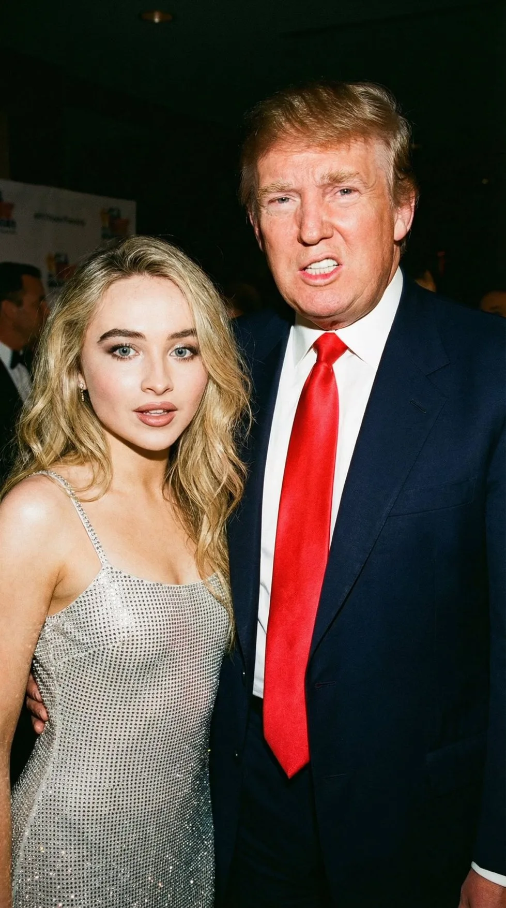

# Rowan — by @rowanali09

[← Back to Community Examples](../../EXAMPLES.md) · Category: Photography · Model: `Nano Banana`

<a href="https://x.com/rowanali09/status/2009167827262193907"></a>

Source: **[@rowanali09 on X](https://x.com/rowanali09/status/2009167827262193907)** · Creator: [Rowan](https://x.com/rowanali09)

## Prompt

```text
Donald Trump and Sabrina Carpenter

Nano Banana Pro 

Prompt:

{
  "lighting": {
    "mood": "Candid, slightly harsh evening lighting",
    "type": "On-camera flash",
    "shadows": "Strong shadows visible, especially on the woman's neck and behind the subjects",
    "direction": "Frontal lighting",
    "intensity": "Harsh, creating highlights on faces and the dress"
  },
  "background": {
    "setting": "Likely an indoor evening event or party",
    "elements": "Faint, indistinct shapes of other people or objects in the distance",
    "description": "Extremely dark and underexposed due to flash",
    "depth_of_field": "Shallow, background is completely blurred"
  },
  "typography": {
    "details": "No visible text or logos",
    "present": "None"
  },
  "composition": {
    "angle": "Slightly from the right, eye-level",
    "focus": "Sharp focus on the two subjects, particularly their faces",
    "framing": "Tight framing on the couple",
    "shot_type": "Medium shot",
    "orientation": "Portrait",
    "positioning": "Woman on the left, man on the right, standing closely together"
  },
  "color_profile": {
    "palette": "Dark suit, bright red tie, silver sparkling dress, warm skin tones, dark background",
    "contrast": "High contrast due to flash",
    "saturation": "Moderate saturation",
    "color_grading": "Typical 1990s flash photography, slightly warm hues",
    "dominant_colors": [
      "#000000",
      "#FFFFFF",
      "#C0C0C0",
      "#FF0000"
    ]
  },
  "technical_specs": {
    "grain": "Visible film grain",
    "source": "Photograph, likely film from the 1990s",
    "sharpness": "Relatively sharp on subjects, background is blurry and dark",
    "resolution": "Medium resolution scan",
    "aspect_ratio": "Approx. 9:16 (square)"
  },
  "subject_analysis": {
    "man": {
      "hair": "Blonde, brushed back",
      "attire": "Dark navy suit, white collared shirt, bright red tie",
      "identity": "Donald Trump (younger)",
      "position": "Right side of the frame",
      "expression": "Mouth open, possibly speaking or grimacing"
    },
    "woman": {
      "hair": "Shoulder-length blonde hair",
      "attire": "Silver, sparkling, spaghetti-strap dress",
      "jewelry": "Small earring visible on left ear",
      "identity": "Blonde woman (possibly Kara Young)",
      "position": "Left side of the frame",
      "expression": "Looking directly at camera, slightly open mouth"
    }
  },
  "artistic_elements": {
    "mood": "Slightly awkward, caught-in-the-moment",
    "style": "Candid celebrity snapshot",
    "texture": "Prominent texture of the woman's sparkling silver dress",
    "expression": "Man is speaking or grimacing, woman is looking directly at the camera with a slightly open mouth",
    "compositional_balance": "Balanced, with the two subjects occupying the majority of the frame"
  },
  "generation_parameters": {
    "prompt": "A candid photograph from the 1990s of Donald Trump in a dark suit and red tie, standing next to a blonde woman in a silver sparkling dress. Both are looking at the camera, with Trump's mouth open. The image is taken with an on-camera flash at an evening event, with a very dark background.",
    "style_tags": [
      "1990s photography",
      "flash photography",
      "candid snapshot",
      "celebrity photo"
    ],
    "negative_prompt": "modern photography, digital look, bright background, perfectly posed, studio lighting"
  }
}
```

## Try it

Paste the prompt into **[vinano.ai](https://vinano.ai?utm_source=github&utm_medium=readme&utm_campaign=awesome-image-video-prompts-updating&utm_content=x-page-try)** to generate your own version.

> The image and prompt belong to @rowanali09 ([original post](https://x.com/rowanali09/status/2009167827262193907)) and are shown here with credit for reference. Creators can ask for changes or removal by opening an issue.
