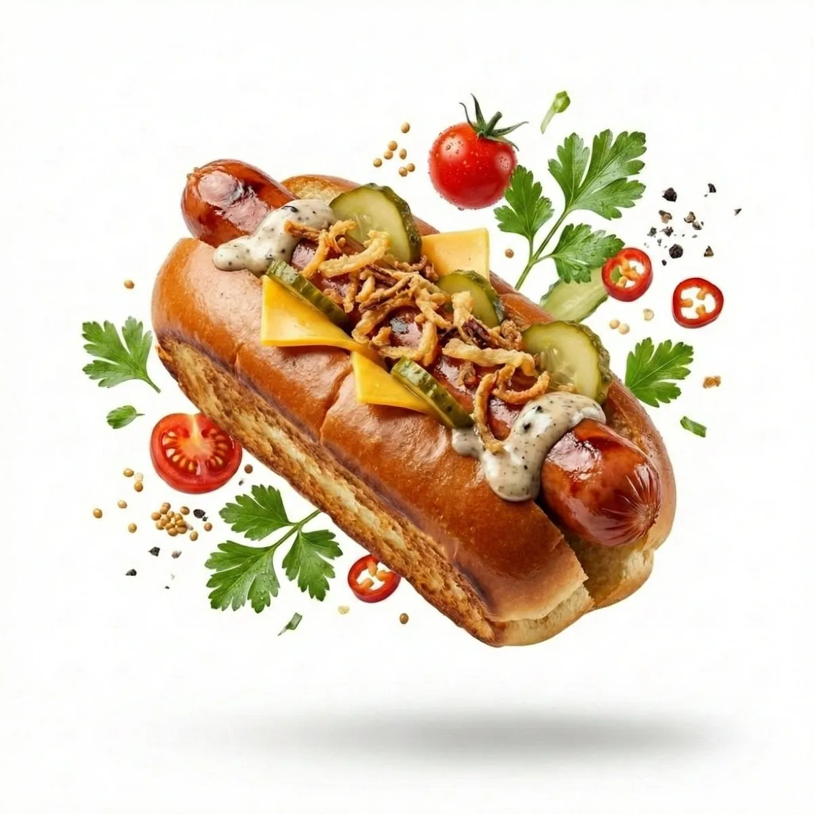

# Taaruk — by @Taaruk_

[← Back to Community Examples](../../EXAMPLES.md) · Category: Food & Drink · Model: `Nano Banana`

<a href="https://x.com/Taaruk_/status/2016058734271987737"></a>

Source: **[@Taaruk_ on X](https://x.com/Taaruk_/status/2016058734271987737)** · Creator: [Taaruk](https://x.com/Taaruk_)

## Prompt

```text
{
  "image_prompt": {
    "main_concept": "High-end commercial food photography with a floating composition (food levitation effect).",
    "composition": {
      "arrangement": "Hero food item suspended in mid-air with complementary ingredients orbiting in perfect balance",
      "background": "Pure white background",
      "shadows": "Soft shadows beneath the suspended food"
    },
    "subject_variations": [
      {
        "item": "Creamy raspberry ice cream",
        "details": "Pistachio crumbs, chocolate chunks, mint leaves, berry drizzle"
      },
      {
        "item": "Gourmet hotdog",
        "details": "Glossy sausage, toasted bun, melted cheese, pickles, crispy onions, herbs, sauce"
      },
      {
        "item": "Handmade dumplings",
        "details": "Visible filling, fresh herbs, spices, pumpkin pieces, dipping sauce"
      }
    ],
    "lighting_and_color": {
      "type": "Studio lighting",
      "highlights": "Clean highlights",
      "color_accuracy": "Natural color accuracy, realistic depth"
    },
    "technical_specs": {
      "style": "Minimalist luxury aesthetic, modern advertising style, commercial product photography",
      "focus": "Ultra-sharp focus on textures, crisp edges",
      "quality": "Hyper-realistic details, high resolution, 8K quality"
    }
  }
}
```

## Try it

Paste the prompt into **[vinano.ai](https://vinano.ai?utm_source=github&utm_medium=readme&utm_campaign=awesome-image-video-prompts-updating&utm_content=x-page-try)** to generate your own version.

> The image and prompt belong to @Taaruk_ ([original post](https://x.com/Taaruk_/status/2016058734271987737)) and are shown here with credit for reference. Creators can ask for changes or removal by opening an issue.
