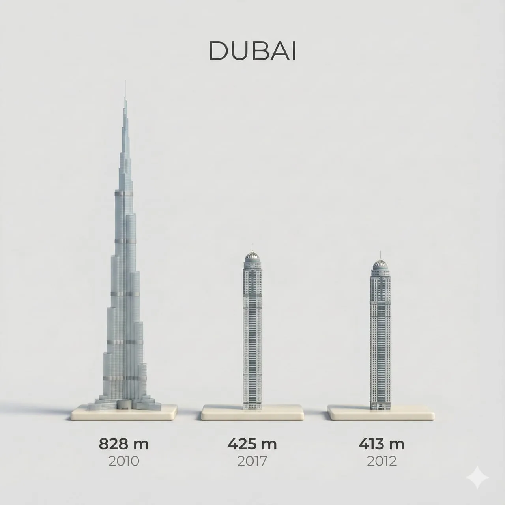

# Milo — by @Milo_Bahi_02

[← Back to Examples from X](../../EXAMPLES.md) · Category: Illustration & 3D · Model: `Nano Banana`

<a href="https://x.com/Milo_Bahi_02/status/2009073595776204834"></a>

Original post: **[@Milo_Bahi_02 on X](https://x.com/Milo_Bahi_02/status/2009073595776204834)** · Creator: [Milo](https://x.com/Milo_Bahi_02)

## Prompt

```text
Ultra-Realistic Promotional
Present a clear, side miniature 3D cartoon view of [DUBAI] tallest buildings. Use minimal textures with realistic materials and soft, lifelike lighting and shadows. Use a clean, minimalistic composition showing exactly the three tallest buildings in spot, arranged from LEFT to RIGHT in STRICT descending height order. The tallest must appear visibly tallest, the second must be clearly shorter than the first, and the third must be clearly shorter than the second.
All buildings must follow accurate relative proportions: if a building is taller in real life, it MUST be taller in the image by the same approximate ratio. No building may be visually stretched or compressed. Each building should stand separately on a thin, simple ceramic base.
Below each base, centered text should display:
Height in meters – semibold sans-serif, medium size
Year built – lighter-weight sans-serif, smaller size, directly beneath the height text
Provide consistent padding, spacing, leading, and kerning. Write “DUBAI” centered above the buildings using a medium-sized sans-serif font. No building top should overlap or touch the text above. Use accurate architectural proportions based on real-world references. Maintain consistent camera angle and identical scale for each building model.
No forced perspective. Use straight-on orthographic-style rendering. Do not exaggerate or stylize size differences beyond proportional accuracy. Use a square 1080x1080 composition. Use a clean, neutral background. Ensure no extra objects are present.
```

## Try it

Paste the prompt into **[vinano.ai](https://vinano.ai?utm_source=github&utm_medium=readme&utm_campaign=awesome-image-video-prompts-updating&utm_content=x-page-try)** to generate your own version.

> The image and prompt belong to [@Milo_Bahi_02](https://x.com/Milo_Bahi_02) and are shown here with credit for reference. Creators can ask for changes or removal by opening an issue.
