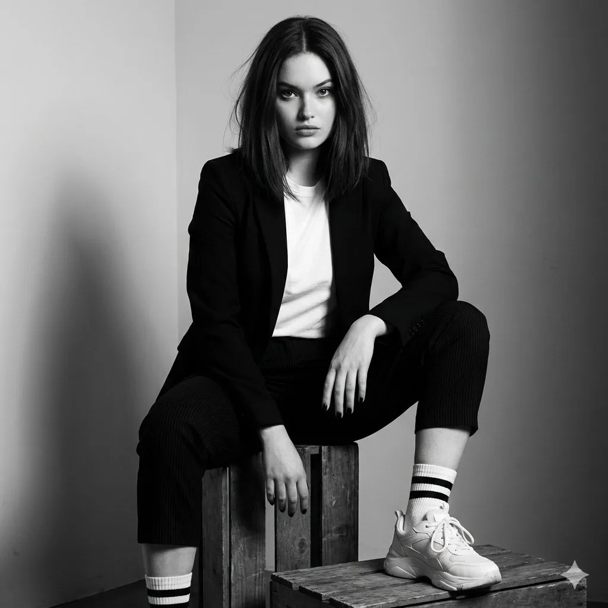

# Anissa — by @SimplyAnnisa

[← Back to Community Examples](../../EXAMPLES.md) · Category: Photography · Model: `Nano Banana`

<a href="https://x.com/SimplyAnnisa/status/2010210760023248929"></a>

Source: **[@SimplyAnnisa on X](https://x.com/SimplyAnnisa/status/2010210760023248929)** · Creator: [Anissa](https://x.com/SimplyAnnisa)

## Prompt

```text
Create a realistic portrait (100% identical face, no editing allowed).
A hyper-realistic black-and-white portrait of a young beautiful woman with a calm, serious, and introspective expression, sitting casually on a stack of rustic wooden crates in a minimalist studio setting. She faces the camera directly with a relaxed yet confident posture, her legs slightly apart, one hand resting naturally between her knees and the other loosely stretched across her thigh, creating a powerful editorial fashion pose.
She has straight, dark, shoulder-length hair with a natural center parting, slightly tousled, gently framing her face. Her facial features are delicate and symmetrical, with a naturally smooth skin texture, subtle shadows under her eyes, soft, slightly parted lips, and deep, expressive eyes staring directly into the lens, conveying a calm confidence and emotional depth. The lack of heavy makeup emphasizes the natural editorial aesthetic.
Clothing & Style:
She wears a fitted black blazer with structured shoulders over a simple white crew-neck T-shirt, paired with cropped black striped trousers. On her feet are modern, chunky white sneakers, paired with white calf-length socks with bold black horizontal stripes, adding a casual street-style contrast to the formal blazer.  Minimal accessories, no visible jewelry. Her nails are painted black.
Lighting & Ambiance:
High-contrast cinematic lighting with strong, directional natural light coming in from the side, creating dramatic diagonal streaks of light and shadow on the plain studio walls and partly on her body. The lighting creates depth, texture, and a moody editorial atmosphere reminiscent of a high-end fashion magazine. Soft shadows preserve facial details while maintaining strong contrast.
Camera & Composition:
Medium-full-length shot, eye-level perspective, centered composition. Shot with a professional DSLR or medium format camera, using a prime lens (50mm–85mm). Shallow depth of field with sharp focus on the subject, subtle background blur. Sharp details, subtle texture of fabric, visible skin pores, realistic falloff.

Style & Quality:
Editorial fashion photography, minimalist, cinematic, monochrome aesthetic, Vogue-style portraiture, ultra-high resolution, sharp focus, film-like contrast, timeless and modern atmosphere.
```

## Try it

Paste the prompt into **[vinano.ai](https://vinano.ai?utm_source=github&utm_medium=readme&utm_campaign=awesome-image-video-prompts-updating&utm_content=x-page-try)** to generate your own version.

> The image and prompt belong to @SimplyAnnisa ([original post](https://x.com/SimplyAnnisa/status/2010210760023248929)) and are shown here with credit for reference. Creators can ask for changes or removal by opening an issue.
