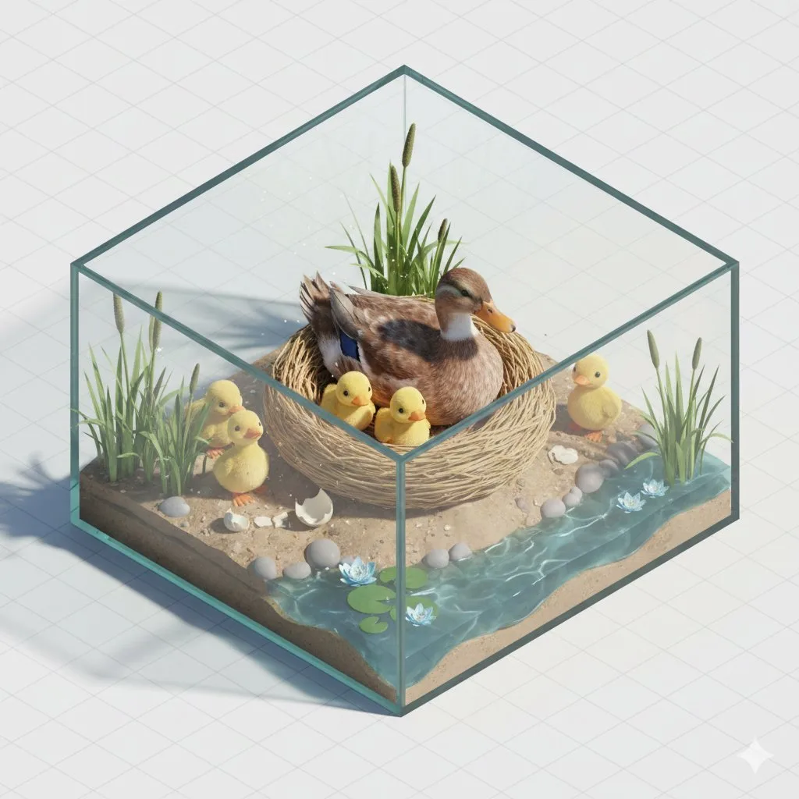

# Sharon Riley — by @Just_sharon7

[← Back to Community Examples](../../EXAMPLES.md) · Category: Illustration & 3D · Model: `Nano Banana`

<a href="https://x.com/Just_sharon7/status/2012034903433716185"></a>

Source: **[@Just_sharon7 on X](https://x.com/Just_sharon7/status/2012034903433716185)** · Creator: [Sharon Riley](https://x.com/Just_sharon7)

## Prompt

```text
Isometric miniature nature diorama showing a mother [PARROT]  feeding newborn chicks in a nest on a tree branch. Leaves forming clean geometric layers, soft sky background, light breeze effect. Balanced lighting, pastel greens and blues, wholesome storybook atmosphere. Clean isometric perspective, macro detail, professional 3D render.
```

## Try it

Paste the prompt into **[vinano.ai](https://vinano.ai?utm_source=github&utm_medium=readme&utm_campaign=awesome-image-video-prompts-updating&utm_content=x-page-try)** to generate your own version.

> The image and prompt belong to @Just_sharon7 ([original post](https://x.com/Just_sharon7/status/2012034903433716185)) and are shown here with credit for reference. Creators can ask for changes or removal by opening an issue.
