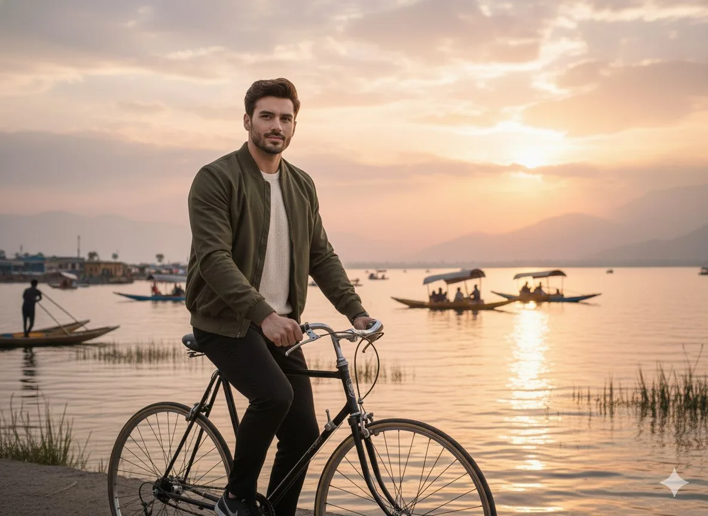

# Kashberg — by @Kashberg_0

[← Back to Examples from X](../../EXAMPLES.md) · Category: Photography · Model: `Nano Banana`

<a href="https://x.com/Kashberg_0/status/2008445407052050856"></a>

Original post: **[@Kashberg_0 on X](https://x.com/Kashberg_0/status/2008445407052050856)** · Creator: [Kashberg](https://x.com/Kashberg_0)

## Prompt

```text
A realistic cinematic photograph of a handsome man riding a bicycle along the edge of Dal Lake at sunset, wearing an olive-green jacket over a light sweater, black trousers and dark shoes. He has short styled hair and a trimmed beard, looking calmly toward the camera with a slight confident expression. Warm golden-hour light reflecting on the lake, traditional shikara boats with people rowing in the background, soft ripples in the water, distant mountains under a pastel sky with orange and pink hues. Shallow depth of field, natural colors, high detail, lifestyle travel photography, ultra-realistic, 4K quality.
```

## Try it

Paste the prompt into **[vinano.ai](https://vinano.ai?utm_source=github&utm_medium=readme&utm_campaign=awesome-image-video-prompts-updating&utm_content=x-page-try)** to generate your own version.

> The image and prompt belong to [@Kashberg_0](https://x.com/Kashberg_0) and are shown here with credit for reference. Creators can ask for changes or removal by opening an issue.
