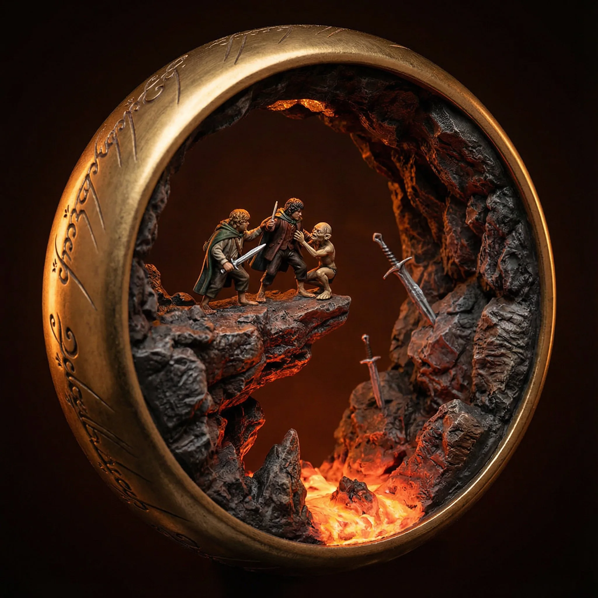

# Gadgetify — by @Gdgtify

[← Back to Community Examples](../../EXAMPLES.md) · Category: Illustration & 3D · Model: `Nano Banana`

<a href="https://x.com/Gdgtify/status/2009115596286214435"></a>

Source: **[@Gdgtify on X](https://x.com/Gdgtify/status/2009115596286214435)** · Creator: [Gadgetify](https://x.com/Gdgtify)

## Prompt

```text
<instructions> you are a world class visual artist and viral content generator tasked with creating high-concept 3D diorama for games or books. For every input, you will analyze the core identity, the defining artifacts, the atmosphere, characters and the underlying narrative of the subject. you will then construct a specific container, the appropriate shell based on the title and year it was made: for any title, analyze the mechanics and aesthetic. visualize a hollowed-out item. the interior is a diorama of a famous level. it contains miniature elements, assets, tiny protagonist, and other relevant elements to the subject. lighting & style should be appropriate for the title </instructions>
```

## Try it

Paste the prompt into **[vinano.ai](https://vinano.ai?utm_source=github&utm_medium=readme&utm_campaign=awesome-image-video-prompts-updating&utm_content=x-page-try)** to generate your own version.

> The image and prompt belong to @Gdgtify ([original post](https://x.com/Gdgtify/status/2009115596286214435)) and are shown here with credit for reference. Creators can ask for changes or removal by opening an issue.
