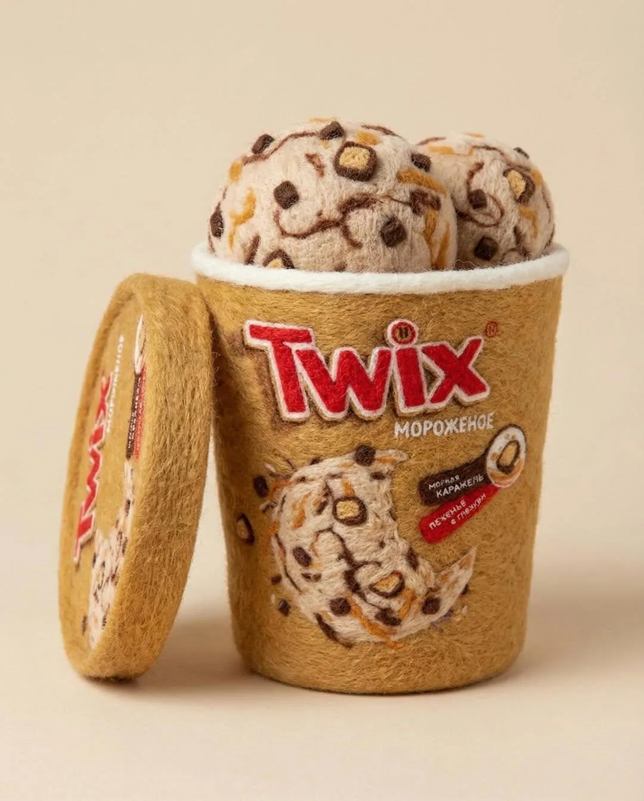

# Sharon Riley — by @Just_sharon7

[← Back to Community Examples](../../EXAMPLES.md) · Category: Food & Drink · Model: `Nano Banana`

<a href="https://x.com/Just_sharon7/status/2009566056227238069"></a>

Source: **[@Just_sharon7 on X](https://x.com/Just_sharon7/status/2009566056227238069)** · Creator: [Sharon Riley](https://x.com/Just_sharon7)

## Prompt

```text
{
  "prompt": "A realistic, needle-felted sculpture of a product from a photo, captured in a high-detail macro studio shot with a whimsical aesthetic.",
  "subject": {
    "type": "Needle-felted sculpture",
    "based_on": "User-provided product photograph",
    "material": "Soft wool felt",
    "attributes": [
      "Fluffy textures",
      "Hand-felted details",
      "Soft edges",
      "Cozy appearance",
      "3D look"
    ]
  },
  "photography": {
    "shot_type": "Studio shot",
    "focus": "Macro focus",
    "detail_level": "High detail"
  },
  "lighting": {
    "type": "Soft, diffused lighting",
    "mood": "Warm and gentle"
  },
  "setting": {
    "background": "Minimal, solid pastel color"
  },
  "aesthetics": {
    "overall_style": "Whimsical and charming"
  },
  "parameters": {
    "aspect_ratio": "4:5"
  }
}
```

## Try it

Paste the prompt into **[vinano.ai](https://vinano.ai?utm_source=github&utm_medium=readme&utm_campaign=awesome-image-video-prompts-updating&utm_content=x-page-try)** to generate your own version.

> The image and prompt belong to @Just_sharon7 ([original post](https://x.com/Just_sharon7/status/2009566056227238069)) and are shown here with credit for reference. Creators can ask for changes or removal by opening an issue.
