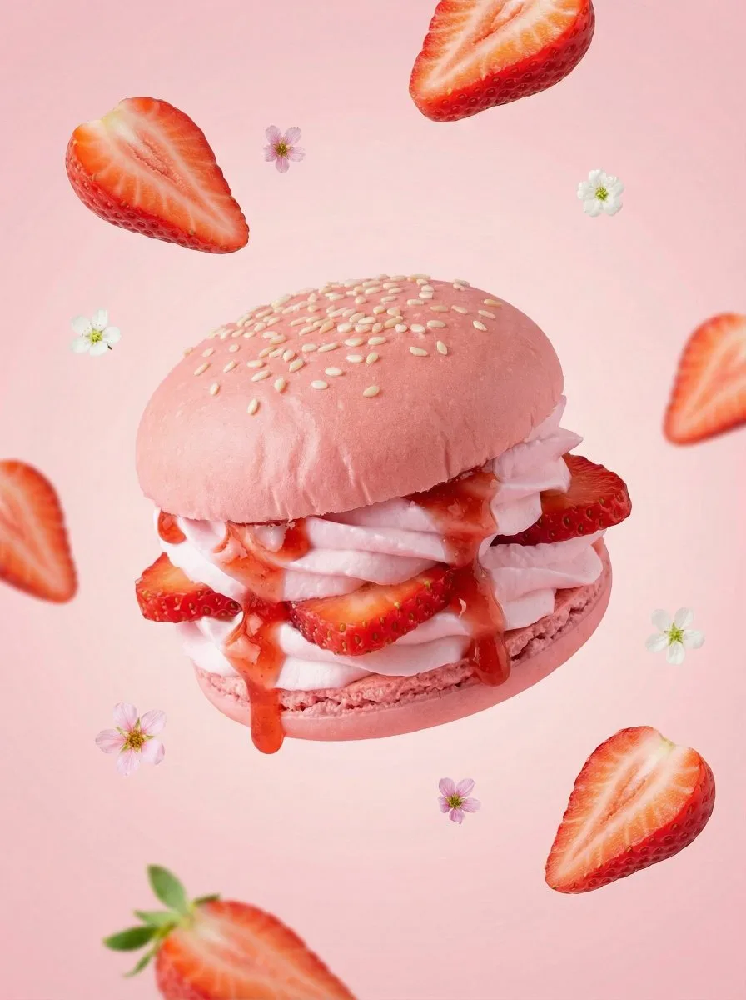

# Latte — by @0xbisc

[← Back to Examples from X](../../EXAMPLES.md) · Category: Food & Drink · Model: `Nano Banana`

<a href="https://x.com/0xbisc/status/2018350105787879512"></a>

Original post: **[@0xbisc on X](https://x.com/0xbisc/status/2018350105787879512)** · Creator: [Latte](https://x.com/0xbisc)

## Prompt

```text
A hyper-realistic {FRUIT} dessert burger, centered composition, soft pastel {FRUIT_COLOR} color palette. Fluffy {FRUIT_COLOR} burger buns with smooth matte texture and light sesame seeds on top. Layers of fresh sliced {FRUIT} and airy white whipped cream inside, with glossy {FRUIT} sauce dripping naturally. Floating {FRUIT} slices and tiny flowers surrounding the burger. Minimal {FRUIT_COLOR} gradient background, soft studio lighting, luxury food advertising style, ultra clean, high detail, shallow depth of field.
```

## Try it

Paste the prompt into **[vinano.ai](https://vinano.ai?utm_source=github&utm_medium=readme&utm_campaign=awesome-image-video-prompts-updating&utm_content=x-page-try)** to generate your own version.

> The image and prompt belong to [@0xbisc](https://x.com/0xbisc) and are shown here with credit for reference. Creators can ask for changes or removal by opening an issue.
