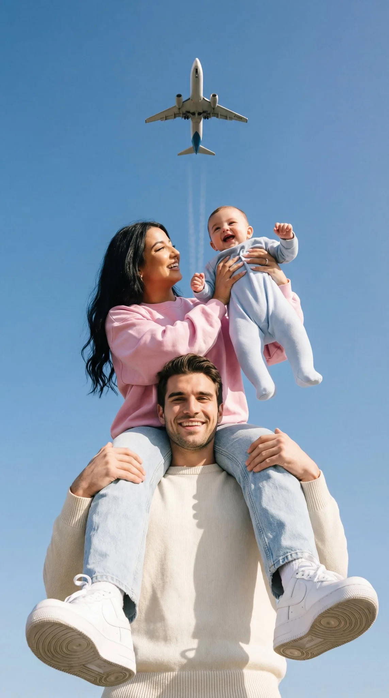

# Özge Döner — by @astronomerozge1

[← Back to Examples from X](../../EXAMPLES.md) · Category: Photography · Model: `Nano Banana`

<a href="https://x.com/astronomerozge1/status/2008270616206483695"></a>

Original post: **[@astronomerozge1 on X](https://x.com/astronomerozge1/status/2008270616206483695)** · Creator: [Özge Döner](https://x.com/astronomerozge1)

## Prompt

```text
{
  "generation_request": {
    "meta_data": {
      "tool": "NanoBanana Pro",
      "task_type": "photoreal_cinematic_travel_couple_low_angle_airplane_overhead_with_baby",
      "version": "v1.1_SHOULDERS_CARRY_PLANE_SKY_HERO_SHOT_BABY_LIFT",
      "priority": "highest"
    },
    "references": {
      "female_reference_image": {
        "slot": 1,
        "purpose": "FEMALE_IDENTITY_LOCK",
        "strict_identity_lock": true
      },
      "male_reference_image": {
        "slot": 2,
        "purpose": "MALE_IDENTITY_LOCK",
        "strict_identity_lock": true
      },
      "composition_reference_image": {
        "source": "UPLOAD_REFERENCE_IMAGE (OPTIONAL)",
        "purpose": "COMPOSITION_POSE_PROP_LOCK",
        "strict_lock": true,
        "no_layout_drift": true,
        "preserve_framing": true
      }
    },
    "output_settings": {
      "aspect_ratio": "4:5",
      "orientation": "portrait",
      "resolution": "ultra_high_res",
      "render_style": "ultra_photoreal_cinematic_lifestyle",
      "sharpness": "crisp_but_natural",
      "film_grain": "subtle_analog",
      "color_grade": "clean_true_to_life_warm_daylight"
    },
    "hard_constraints": [
      "Exactly 3 subjects only: one female, one male, and one baby (infant/toddler).",
      "Faces of the adult couple must match the uploaded references with maximum similarity (no morphing).",
      "Match the reference composition: extreme low-angle hero shot, man carrying woman on his shoulders.",
      "Woman holds the baby securely and lifts the baby slightly upward (safe, realistic lift; not extreme).",
      "A commercial airplane must be clearly visible overhead in the sky (top area of frame).",
      "No text, no logos, no watermark.",
      "Photoreal anatomy (no extra limbs/fingers), realistic footwear and clothing folds."
    ],
    "camera": {
      "style": "cinematic travel lifestyle photo",
      "lens": "24mm",
      "aperture": "f/2.8",
      "focus": "sharp on couple faces and baby, slight falloff toward shoes",
      "shutter_speed": "1/1600",
      "iso": 100,
      "white_balance": "bright clear daylight"
    },
    "lighting": {
      "type": "direct sunny daylight",
      "contrast": "medium",
      "highlights": "natural sun highlights, controlled (no blown skin)",
      "shadows": "soft-ish due to open sky bounce"
    },
    "prompt": {
      "scene_summary": "Ultra-photoreal cinematic travel lifestyle photo. Extreme low-angle hero perspective looking up at a family against a wide open blue sky. The man carries the woman on his shoulders; she sits securely with legs draped to each side, sneakers visible close to camera. The woman holds a baby securely and lifts the baby upward in a joyful 'flying' moment (safe realistic lift: baby raised only slightly above her face level, supported with both hands, baby’s head/neck naturally supported). The man smiles, holding the woman’s legs/ankles for support, stance stable and natural. A commercial passenger airplane flies overhead, centered near the top of the frame, clearly recognizable with realistic scale, motion blur minimal.\n\nWardrobe & vibe (match reference):\n- Soft casual neutrals: man in a cream/beige sweater and light denim; woman in an oversized pastel/pink sweatshirt; clean white sneakers.\n- Baby in a simple pastel onesie (no text/logos), weather-appropriate.\n- Natural, candid happiness; relaxed weekend travel vibe.\n\nComposition & realism:\n- Blue sky fills most of the background; minimal clouds.\n- Strong perspective distortion typical of a 24mm lens; sneakers and legs appear slightly larger due to proximity.\n- Realistic skin texture, fabric knit detail, and accurate shadows.\n- Ensure faces are clearly visible and sharp, with natural expressions (no beautify filter).\n\nSafety/pose realism:\n- Baby is held securely with both hands, no extreme overhead throwing, no unsafe angles.",
      "styling_notes": [
        "keep the exact low-angle hero shot",
        "man carrying woman on shoulders remains the core pose",
        "woman lifts baby slightly upward while keeping secure support",
        "airplane must be visible and not cropped",
        "avoid sunglasses unless they exist in the identity references"
      ]
    },
    "negative_prompt": [
      "extra people",
      "missing airplane",
      "airplane cropped",
      "unsafe baby pose (throwing baby high)",
      "baby unsupported head/neck",
      "cartoon",
      "anime",
      "cgi",
      "plastic skin",
      "over-smoothing",
      "face morph",
      "identity drift",
      "deformed hands",
      "extra fingers",
      "extra limbs",
      "text",
      "logo",
      "watermark",
      "blown highlights"
    ]
  }
}
```

## Try it

Paste the prompt into **[vinano.ai](https://vinano.ai?utm_source=github&utm_medium=readme&utm_campaign=awesome-image-video-prompts-updating&utm_content=x-page-try)** to generate your own version.

> The image and prompt belong to [@astronomerozge1](https://x.com/astronomerozge1) and are shown here with credit for reference. Creators can ask for changes or removal by opening an issue.
