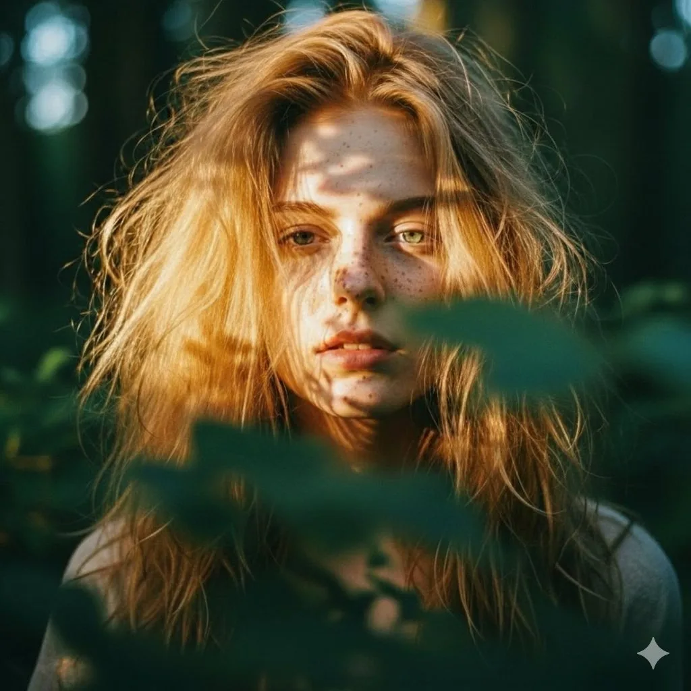

# Aijaz — by @iamsofiaijaz

[← Back to Examples from X](../../EXAMPLES.md) · Category: Photography · Model: `Nano Banana`

<a href="https://x.com/iamsofiaijaz/status/2016479730980290977"></a>

Original post: **[@iamsofiaijaz on X](https://x.com/iamsofiaijaz/status/2016479730980290977)** · Creator: [Aijaz](https://x.com/iamsofiaijaz)

## Prompt

```text
Close-up portrait of a young woman with messy, voluminous strawberry blonde hair and heavy freckles across her nose and cheeks. She is partially obscured by dark green forest foliage in the foreground. Dramatic cinematic lighting with dappled golden sunlight filtering through leaves, creating high-contrast shadows across her face. Dreamy, ethereal atmosphere, soft bokeh background of a dense forest, shot on 35mm film, earthy tones, hyper-realistic skin textures.
​Key Elements to Tweak
​If you want to adjust the vibe, try changing these specific keywords:
​Lighting: Swap "dappled sunlight" for "rim lighting" to get a glowing outline around her hair, or "overcast" for a moodier, softer look.
​Framing: Use "extreme close-up" to focus purely on the eyes and freckles, or "medium shot" to show more of the forest environment.
​Color Palette: Add "analog film aesthetic" for that slightly grainy, nostalgic feel seen in your image, or "vibrant forest greens" to make the leaves pop.
```

## Try it

Paste the prompt into **[vinano.ai](https://vinano.ai?utm_source=github&utm_medium=readme&utm_campaign=awesome-image-video-prompts-updating&utm_content=x-page-try)** to generate your own version.

> The image and prompt belong to [@iamsofiaijaz](https://x.com/iamsofiaijaz) and are shown here with credit for reference. Creators can ask for changes or removal by opening an issue.
