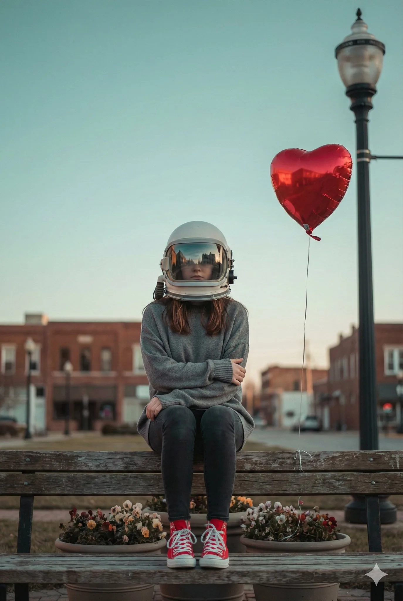

# Heisenberg — by @rovvmut_

[← Back to Community Examples](../../EXAMPLES.md) · Category: Photography · Model: `Nano Banana`

<a href="https://x.com/rovvmut_/status/2008767364675104818"></a>

Source: **[@rovvmut_ on X](https://x.com/rovvmut_/status/2008767364675104818)** · Creator: [Heisenberg](https://x.com/rovvmut_)

## Prompt

```text
{
"image_type": "photograph",
"orientation": "vertical",
"aspect_ratio": "2:3",
"composition": {
"framing": "centered subject with strong vertical symmetry",
"rule_of_thirds": "subject centered vertically, balloon positioned upper-right third",
"depth": "moderate depth of field with softly blurred background",
"leading_elements": "bench slats and lamppost create vertical and horizontal structure",
"negative_space": "open sky occupying upper half of frame"
},
"primary_subject": {
"description": "young person seated on a wooden park bench wearing an astronaut helmet",
"pose": "seated, knees together, arms folded inward, posing towards camera",
"emotion": "introspective, melancholic, whimsical loneliness",
"clothing": {
"top": "oversized gray sweater",
"bottom": "dark skinny jeans",
"footwear": "red high-top sneakers with white laces",
"accessories": "vintage-style astronaut helmet"
}
},
"secondary_subjects": [
{
"type": "object",
"description": "red heart-shaped helium balloon",
"position": "upper right, tethered to lamppost",
"symbolism": "love, longing, fragility"
},
{
"type": "environment_object",
"description": "classic street lamppost",
"position": "right side of frame",
"function": "anchor point for balloon string"
}
],
"environment": {
"location_type": "urban park or public square",
"foreground": "flower pots with small blooming flowers beneath bench",
"background": "low-rise buildings and distant urban elements",
"sky": "clear with soft gradient"
},
"color_palette": {
"dominant_colors": [
"muted teal sky",
"warm brown wood",
"charcoal gray clothing"
],
"accent_colors": [
"vivid red balloon",
"bright red sneakers"
],
"overall_tone": "muted with selective saturation"
},
"lighting": {
"type": "natural light",
"time_of_day": "golden hour or late afternoon",
"direction": "soft ambient, slightly directional from left",
"contrast": "low to medium",
"highlights": "subtle reflections on astronaut visor and balloon surface",
"shadows": "soft, diffused shadows under bench and subject"
},
"technical_details": {
"camera_angle": "eye-level",
"lens_effect": "slight background compression suggesting mid-range focal length",
"focus": "sharp on subject, gentle background blur",
"grain": "minimal, clean digital look"
},
"artistic_style": {
"genre": "conceptual portrait photography",
"mood": "surreal, poetic, nostalgic",
"themes": [
"isolation",
"imagination",
"emotional distance",
"childhood wonder"
],
"visual_metaphors": [
"astronaut helmet representing emotional separation",
"heart balloon symbolizing unattainable or fragile love"
]
},
"typography": {
"present": false
},
"overall_aesth
etic": "cinematic, dreamy, modern surrealism with lifestyle photography influences"
}
```

## Try it

Paste the prompt into **[vinano.ai](https://vinano.ai?utm_source=github&utm_medium=readme&utm_campaign=awesome-image-video-prompts-updating&utm_content=x-page-try)** to generate your own version.

> The image and prompt belong to @rovvmut_ ([original post](https://x.com/rovvmut_/status/2008767364675104818)) and are shown here with credit for reference. Creators can ask for changes or removal by opening an issue.
