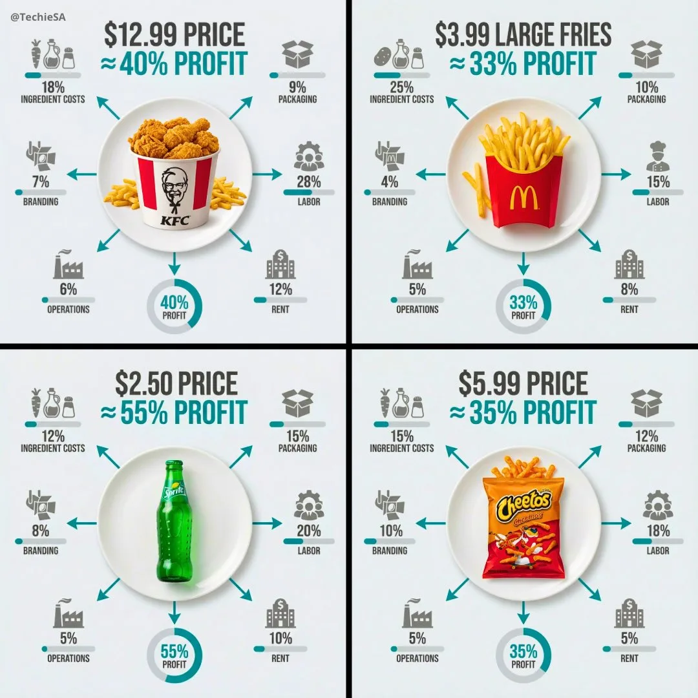

# TechieSA — by @TechieBySA

[← Back to Examples from X](../../EXAMPLES.md) · Category: Illustration & 3D · Model: `Nano Banana`

<a href="https://x.com/TechieBySA/status/2012957106433818777"></a>

Original post: **[@TechieBySA on X](https://x.com/TechieBySA/status/2012957106433818777)** · Creator: [TechieSA](https://x.com/TechieBySA)

## Prompt

```text
Ultra-clean top-down (90° flat lay) infographic. Centered white plate or cup on a light background with [PRODUCT] neatly presented. 

Surround the food with a clear money-flow infographic showing what you pay for: ingredient costs, packaging, labor, rent, branding, operations, and profit. Use icons, percentage bars, pie rings, and arrows flowing outward from the food.

Large price or profit callout as the main focal point, bold sans-serif, high contrast, instantly readable.

Style: premium editorial infographic, Apple UI × National Geographic, clean hierarchy, minimal text, strong visual clarity. Natural food colors, monochrome UI, one accent color for emphasis.

1080×1080, ultra-crisp, no watermark.
```

## Try it

Paste the prompt into **[vinano.ai](https://vinano.ai?utm_source=github&utm_medium=readme&utm_campaign=awesome-image-video-prompts-updating&utm_content=x-page-try)** to generate your own version.

> The image and prompt belong to [@TechieBySA](https://x.com/TechieBySA) and are shown here with credit for reference. Creators can ask for changes or removal by opening an issue.
