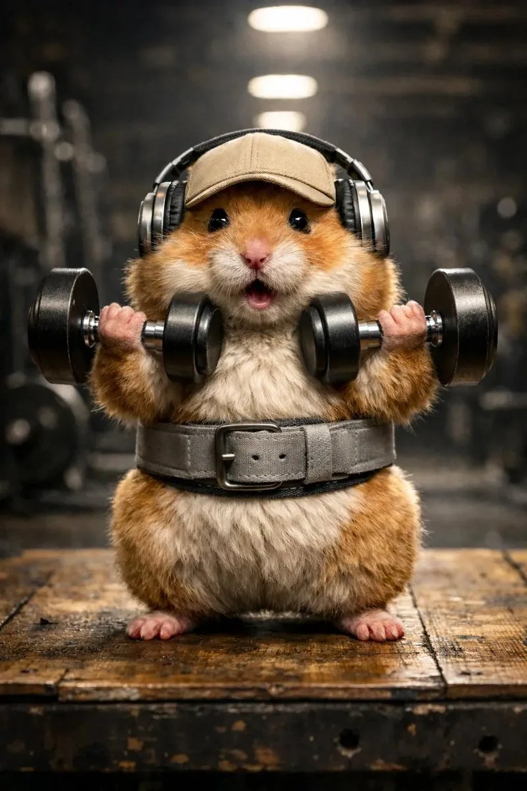

# Sharon Riley — by @Just_sharon7

[← Back to Examples from X](../../EXAMPLES.md) · Category: Illustration & 3D · Model: `Nano Banana`

<a href="https://x.com/Just_sharon7/status/2018258206964027484"></a>

Original post: **[@Just_sharon7 on X](https://x.com/Just_sharon7/status/2018258206964027484)** · Creator: [Sharon Riley](https://x.com/Just_sharon7)

## Prompt

```text
A hyper-detailed, adorable golden hamster in a bright, cheerful gym, animated in smooth cinematic motion. The chubby hamster, fluffy and round, lifts oversized black dumbbells with both tiny paws, bouncing slightly with effort. It wears playful over-ear headphones, a backwards beige baseball cap, and a soft grey weightlifting belt. Mouth open in an excited squeak, eyes sparkling with joy and determination. Warm, soft lighting with gentle shadows shifts subtly across the scene, highlighting floating dust motes and colorful gym equipment. Camera slowly pans around the hamster, showing dynamic angles from three-quarters and low perspectives. Fun textures and whimsical details remain visible throughout. Motion is lively, charming, and heartwarming, 8K ultra-realistic cinematic style, shallow depth of field, soft focus transitions, gentle ambient gym sounds.
--ar 3:4 --stylize 250 --v 6
```

## Try it

Paste the prompt into **[vinano.ai](https://vinano.ai?utm_source=github&utm_medium=readme&utm_campaign=awesome-image-video-prompts-updating&utm_content=x-page-try)** to generate your own version.

> The image and prompt belong to [@Just_sharon7](https://x.com/Just_sharon7) and are shown here with credit for reference. Creators can ask for changes or removal by opening an issue.
