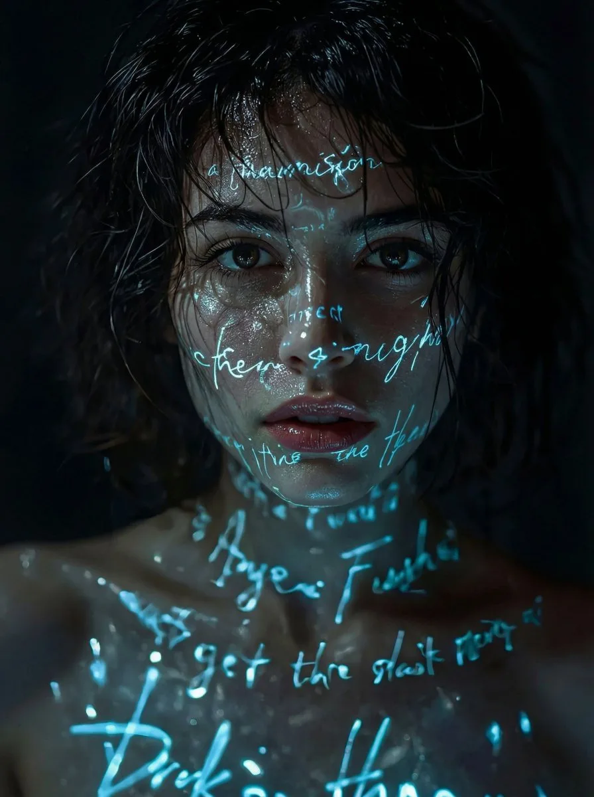

# Aijaz — by @iamsofiaijaz

[← Back to Examples from X](../../EXAMPLES.md) · Category: Photography · Model: `Nano Banana`

<a href="https://x.com/iamsofiaijaz/status/2016139396173725824"></a>

Original post: **[@iamsofiaijaz on X](https://x.com/iamsofiaijaz/status/2016139396173725824)** · Creator: [Aijaz](https://x.com/iamsofiaijaz)

## Prompt

```text
A cinematic, hyper-realistic close-up portrait of a mysterious young woman in darkness, wet skin glistening as if in rain. Neon blue glowing handwritten text and symbols are projected across her face and upper body, wrapping around her eyes, cheeks, lips, and collarbones like living poetry. Her intense gaze looks directly into the camera, eyes sharp and reflective. Damp, tousled hair frames her face, partially shadowed. The lighting is low-key and dramatic, with teal and cyan highlights illuminating her skin while the background fades into deep black. Ultra-detailed skin texture, glossy reflections, shallow depth of field, cyber-poetic aesthetic, futuristic noir mood, emotional and intimate atmosphere, cinematic lighting, 8K, photorealism.
```

## Try it

Paste the prompt into **[vinano.ai](https://vinano.ai?utm_source=github&utm_medium=readme&utm_campaign=awesome-image-video-prompts-updating&utm_content=x-page-try)** to generate your own version.

> The image and prompt belong to [@iamsofiaijaz](https://x.com/iamsofiaijaz) and are shown here with credit for reference. Creators can ask for changes or removal by opening an issue.
