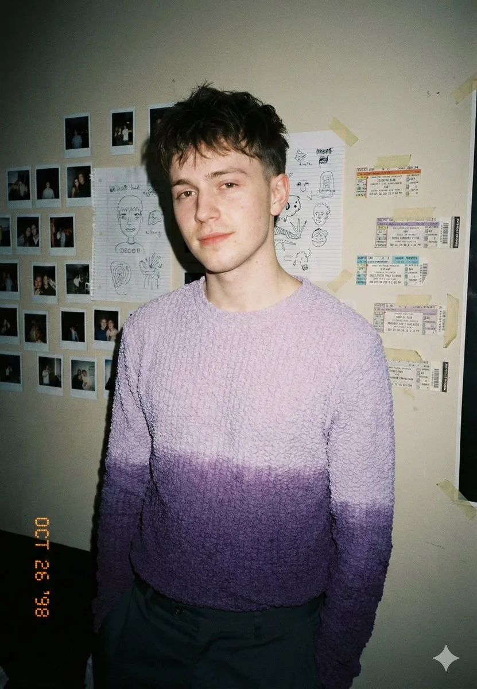

# Maercih — by @Maercihh

[← Back to Community Examples](../../EXAMPLES.md) · Category: Photography · Model: `Nano Banana`

<a href="https://x.com/Maercihh/status/2016448117617602890"></a>

Source: **[@Maercihh on X](https://x.com/Maercihh/status/2016448117617602890)** · Creator: [Maercih](https://x.com/Maercihh)

## Prompt

```text
{
  "scene": "An intimate indoor portrait taken in a personal bedroom or studio space, walls covered with taped photos, sketches, and ticket stubs",
  "subject": {
    "gender": "male",
    "age": "early 20s",
    "expression": "calm, slightly guarded, introspective",
    "pose": "standing casually, shoulders relaxed, slight lean, hands out of frame",
    "gaze": "direct but unforced eye contact with the camera",
    "hair": "short, messy crop with natural volume, slightly uneven fringe",
    "wardrobe": {
      "top": "textured knit sweater with soft purple gradient fade",
      "bottom": "muted trousers, understated and casual",
      "style": "effortless, lived-in, indie editorial"
    }
  },
  "environment": {
    "location": "personal room or creative space",
    "background_elements": [
      "polaroid photographs taped to wall",
      "handwritten sketches and doodles",
      "concert or travel ticket stubs",
      "masking tape visible and imperfect"
    ],
    "atmosphere": "nostalgic, personal, slightly raw"
  },
  "lighting": {
    "type": "direct on-camera flash",
    "quality": "harsh but controlled",
    "shadow": "hard shadows falling behind subject",
    "mood": "late 90s / early 2000s candid realism"
  },
  "camera": {
    "shot_type": "medium portrait",
    "lens": "35mm",
    "perspective": "eye-level, snapshot-style framing",
    "depth_of_field": "deep enough to keep wall details readable",
    "imperfections": "slight vignetting, flash falloff"
  },
  "color_grading": {
    "palette": "muted neutrals with soft lavender emphasis",
    "contrast": "moderate",
    "tones": "natural skin tones with slight warmth"
  },
  "texture_and_detail": {
    "skin": "real texture, visible blemishes, no smoothing",
    "fabric": "clearly defined knit texture",
    "grain": "noticeable film grain",
    "timestamp": "subtle date stamp in corner"
  },
  "style": "analog-inspired, diary-like portrait, lo-fi editorial realism",
  "negative_prompt": [
    "studio lighting",
    "beauty retouching",
    "plastic skin",
    "perfect symmetry",
    "over-sharpening",
    "clean minimal background",
    "AI artifacts"
  ]
}
```

## Try it

Paste the prompt into **[vinano.ai](https://vinano.ai?utm_source=github&utm_medium=readme&utm_campaign=awesome-image-video-prompts-updating&utm_content=x-page-try)** to generate your own version.

> The image and prompt belong to @Maercihh ([original post](https://x.com/Maercihh/status/2016448117617602890)) and are shown here with credit for reference. Creators can ask for changes or removal by opening an issue.
