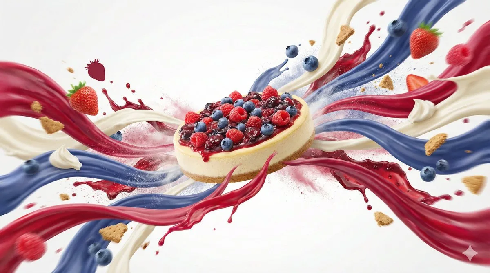

# Aleena Amir — by @aleenaamiir

[← Back to Community Examples](../../EXAMPLES.md) · Category: Food & Drink · Model: `Nano Banana`

<a href="https://x.com/aleenaamiir/status/2013636630842876150"></a>

Source: **[@aleenaamiir on X](https://x.com/aleenaamiir/status/2013636630842876150)** · Creator: [Aleena Amir](https://x.com/aleenaamiir)

## Prompt

```text
Dynamic flavor wave composition of [FOOD], with colorful energy ribbons, mist, and motion streaks bursting outward to represent taste intensity. Ingredient silhouettes embedded within the waves. Clean minimal white background, high-key studio lighting. Ultra-real textures, cinematic motion blur, premium commercial food photography, 8K resolution.
```

## Try it

Paste the prompt into **[vinano.ai](https://vinano.ai?utm_source=github&utm_medium=readme&utm_campaign=awesome-image-video-prompts-updating&utm_content=x-page-try)** to generate your own version.

> The image and prompt belong to @aleenaamiir ([original post](https://x.com/aleenaamiir/status/2013636630842876150)) and are shown here with credit for reference. Creators can ask for changes or removal by opening an issue.
