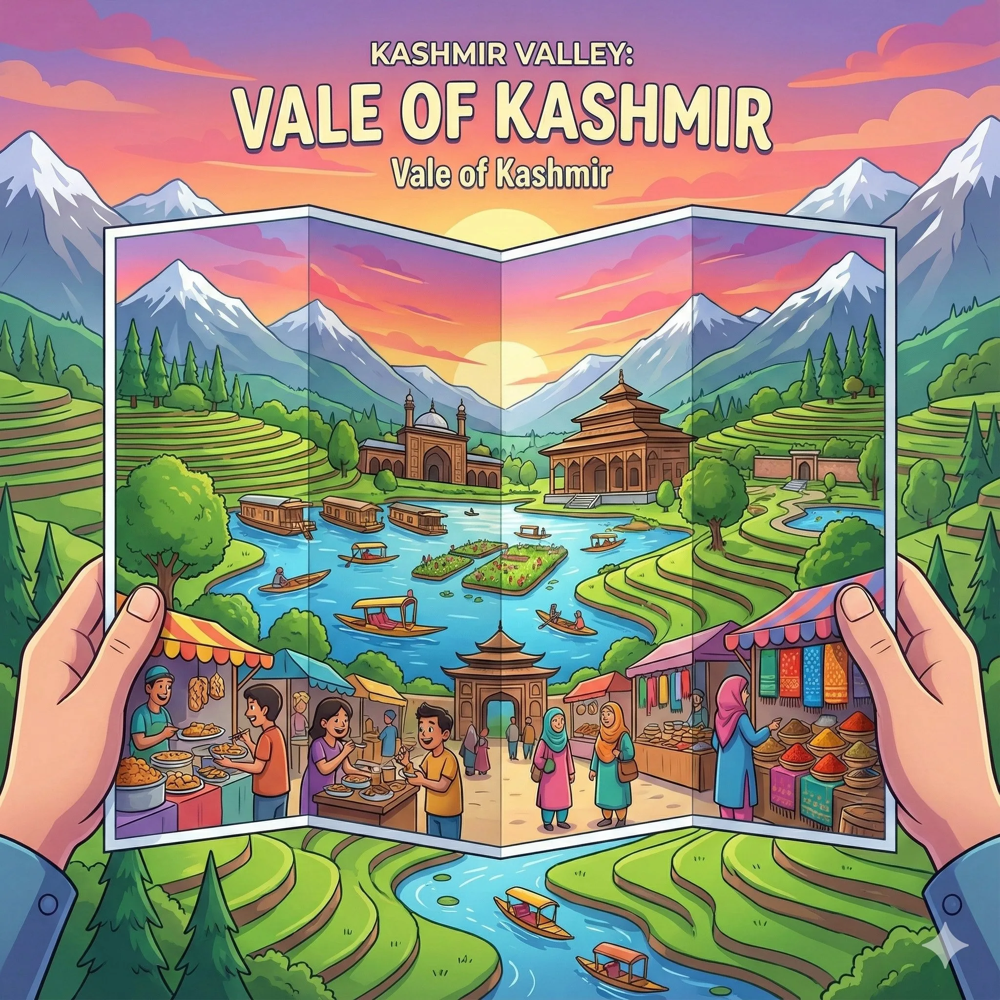

# Milo — by @Milo_Bahi_02

[← Back to Examples from X](../../EXAMPLES.md) · Category: Illustration & 3D · Model: `Nano Banana`

<a href="https://x.com/Milo_Bahi_02/status/2008388128961389047"></a>

Original post: **[@Milo_Bahi_02 on X](https://x.com/Milo_Bahi_02/status/2008388128961389047)** · Creator: [Milo](https://x.com/Milo_Bahi_02)

## Prompt

```text
Ultra-Realistic Promotional
Create a high-resolution 1080x1080 stylized travel poster style illustration that looks like a folded tourist brochure being held by two hands in the foreground. The brochure features a vibrant, cartoonish yet detailed depiction of [KASHMIR VALLEY] Show iconic cultural elements and architecture of [Often Called VALE OF KASHMIR] surrounded by lush greenery or local landscapes. Include shopping scenes with people eating street food at local markets, and colorful [SUN/SUNSET] in the background. The overall style should be Pixar-inspired, bright and cheerful, soft shadows, and rich 3D depth. The hands holding the brochure should be pixar stylized, with gentle shadows and cool tones, matching the exact expression and perspective as the reference image. The background should seamlessly blend and match the landscape extending beyond the brochure edges.
```

## Try it

Paste the prompt into **[vinano.ai](https://vinano.ai?utm_source=github&utm_medium=readme&utm_campaign=awesome-image-video-prompts-updating&utm_content=x-page-try)** to generate your own version.

> The image and prompt belong to [@Milo_Bahi_02](https://x.com/Milo_Bahi_02) and are shown here with credit for reference. Creators can ask for changes or removal by opening an issue.
