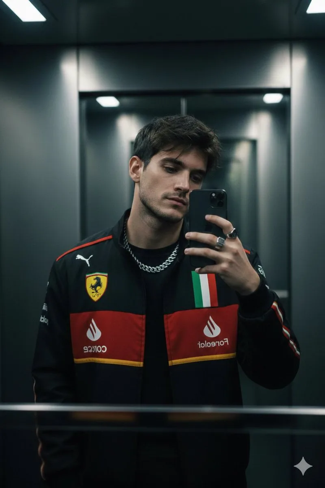

# Aijaz — by @iamsofiaijaz

[← Back to Examples from X](../../EXAMPLES.md) · Category: Photography · Model: `Nano Banana`

<a href="https://x.com/iamsofiaijaz/status/2012349152684896291"></a>

Original post: **[@iamsofiaijaz on X](https://x.com/iamsofiaijaz/status/2012349152684896291)** · Creator: [Aijaz](https://x.com/iamsofiaijaz)

## Prompt

```text
A moody cinematic mirror selfie of a stylish young man use image for face reference with tousled dark hair and light stubble, wearing a black Ferrari racing jacket with red and yellow stripes and motorsport patches. He has a silver chain necklace and multiple rings, holding a modern smartphone in one hand. Low-key dramatic lighting, dark elevator interior with soft reflections, shallow depth of field, sharp focus on the subject’s face. Fashion editorial style, masculine aesthetic, realistic skin texture, ultra-detailed, 35mm photography, cinematic color grading, high contrast, photorealistic, 4K.
```

## Try it

Paste the prompt into **[vinano.ai](https://vinano.ai?utm_source=github&utm_medium=readme&utm_campaign=awesome-image-video-prompts-updating&utm_content=x-page-try)** to generate your own version.

> The image and prompt belong to [@iamsofiaijaz](https://x.com/iamsofiaijaz) and are shown here with credit for reference. Creators can ask for changes or removal by opening an issue.
