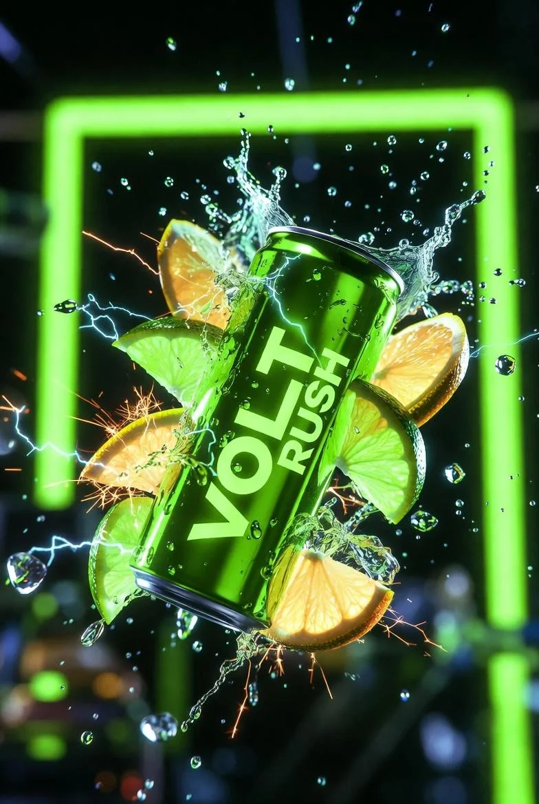

# 𝐌 — by @Strength04_X

[← Back to Community Examples](../../EXAMPLES.md) · Category: Product & Brand · Model: `Nano Banana`

<a href="https://x.com/Strength04_X/status/2011981449688482135"></a>

Source: **[@Strength04_X on X](https://x.com/Strength04_X/status/2011981449688482135)** · Creator: [𝐌](https://x.com/Strength04_X)

## Prompt

```text
Ultra-cinematic product photography of a neon-green energy drink can labeled “VOLT RUSH”, tilted at a sharp diagonal, bursting through glowing citrus slices and electric sparks. Frozen splashes of lime juice and ice shards suspended mid-air, micro droplets visible. High-contrast studio lighting with green neon rim lights, dark background, glossy aluminum texture, shallow depth of field, photorealistic, 8K, premium ad style.
```

## Try it

Paste the prompt into **[vinano.ai](https://vinano.ai?utm_source=github&utm_medium=readme&utm_campaign=awesome-image-video-prompts-updating&utm_content=x-page-try)** to generate your own version.

> The image and prompt belong to @Strength04_X ([original post](https://x.com/Strength04_X/status/2011981449688482135)) and are shown here with credit for reference. Creators can ask for changes or removal by opening an issue.
