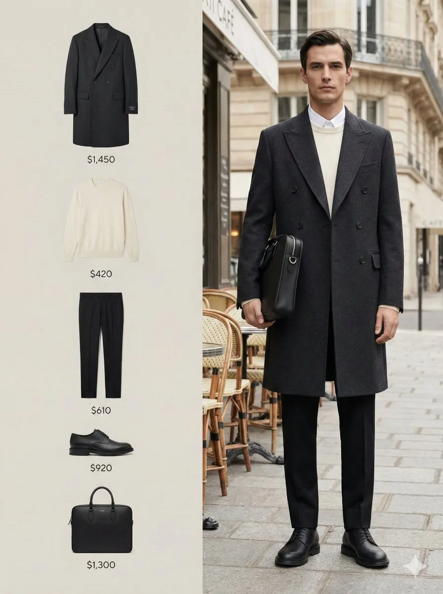

# Kaan — by @kaanakz

[← Back to Community Examples](../../EXAMPLES.md) · Category: Photography · Model: `Nano Banana`

<a href="https://x.com/kaanakz/status/2018098287631630489"></a>

Source: **[@kaanakz on X](https://x.com/kaanakz/status/2018098287631630489)** · Creator: [Kaan](https://x.com/kaanakz)

## Prompt

```text
A high-fashion black and white editorial campaign image with a 3:4 aspect ratio, split into two vertical sections. Strong contrast, rich tonal depth, cinematic grain.
RIGHT SIDE:

A man captured mid-step in a Parisian street café scene. Architecture dissolves into soft gradients and shadow. Light sculpts the face and garments rather than illuminating the scene.
He wears a tweed tailored jacket and matching trousers, the fabric rendered through contrast and texture rather than color. The tweed weave is emphasized through light and shadow.

Black leather Chelsea boots blend into the tonal range.

A structured leather bag appears as a bold silhouette.
Expression is introspective, distant. Movement feels frozen, deliberate.
STYLE & MOOD:

Timeless, cinematic, intellectual, masculine restraint, European fashion cinema.
LEFT SIDE:

A monochrome product composition on a light-to-dark gradient background. Items float slightly, defined by shadow and form. Minimal typographic price indicators.
OVERALL FEEL:

Classic fashion cinema, archival quality, serious tone.
NEGATIVE PROMPT:

Color accents, glossy lighting, modern street aesthetics, commercial catalog look.
```

## Try it

Paste the prompt into **[vinano.ai](https://vinano.ai?utm_source=github&utm_medium=readme&utm_campaign=awesome-image-video-prompts-updating&utm_content=x-page-try)** to generate your own version.

> The image and prompt belong to @kaanakz ([original post](https://x.com/kaanakz/status/2018098287631630489)) and are shown here with credit for reference. Creators can ask for changes or removal by opening an issue.
