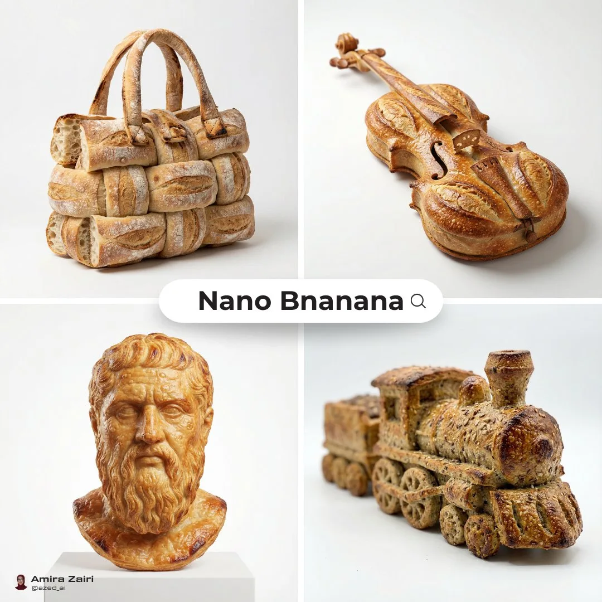

# Amira Zairi — by @azed_ai

[← Back to Community Examples](../../EXAMPLES.md) · Category: Illustration & 3D · Model: `Nano Banana`

<a href="https://x.com/azed_ai/status/2018322783869243790"></a>

Source: **[@azed_ai on X](https://x.com/azed_ai/status/2018322783869243790)** · Creator: [Amira Zairi](https://x.com/azed_ai)

## Prompt

```text
A highly realistic sculpture of a [object], crafted entirely from [bread type], photorealistic, ultra detailed bread texture, authentic crumb structure, golden brown crust with subtle blistering, natural sheen from baked glaze, visible flaky layers or airy pockets where appropriate, sesame or poppy seeds embedded if relevant, tiny cracks and toasted edges, realistic thickness and weight, studio product lighting with soft highlights and gentle shadows, soft neutral seamless background, shallow depth of field, razor sharp focus on the sculpture, 8k, no text, no logos, no watermark
```

## Try it

Paste the prompt into **[vinano.ai](https://vinano.ai?utm_source=github&utm_medium=readme&utm_campaign=awesome-image-video-prompts-updating&utm_content=x-page-try)** to generate your own version.

> The image and prompt belong to @azed_ai ([original post](https://x.com/azed_ai/status/2018322783869243790)) and are shown here with credit for reference. Creators can ask for changes or removal by opening an issue.
