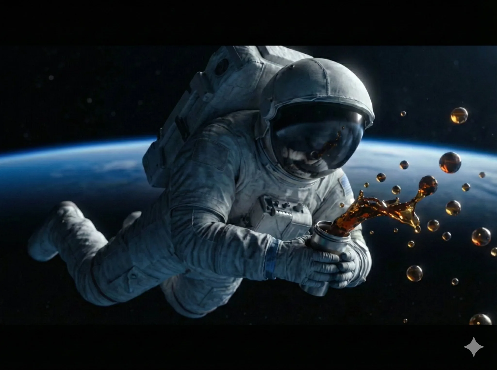

# 𝐌 — by @Strength04_X

[← Back to Community Examples](../../EXAMPLES.md) · Category: Photography · Model: `Nano Banana`

<a href="https://x.com/Strength04_X/status/2008495362529493218"></a>

Source: **[@Strength04_X on X](https://x.com/Strength04_X/status/2008495362529493218)** · Creator: [𝐌](https://x.com/Strength04_X)

## Prompt

```text
A high-detail, cinematic shot of an astronaut floating in outer space with the Earth's blue curvature and atmosphere in the background. The astronaut is wearing a realistic, weathered white space suit. They are holding a metallic thermos from which dark coffee or amber liquid is spilling out, forming perfect spherical droplets and a beautiful splash due to zero gravity. The lighting is dramatic, with a strong glow from the sun reflecting off the helmet's visor and the liquid droplets. 8k resolution, hyper-realistic, photorealistic, cosmic atmosphere.
```

## Try it

Paste the prompt into **[vinano.ai](https://vinano.ai?utm_source=github&utm_medium=readme&utm_campaign=awesome-image-video-prompts-updating&utm_content=x-page-try)** to generate your own version.

> The image and prompt belong to @Strength04_X ([original post](https://x.com/Strength04_X/status/2008495362529493218)) and are shown here with credit for reference. Creators can ask for changes or removal by opening an issue.
