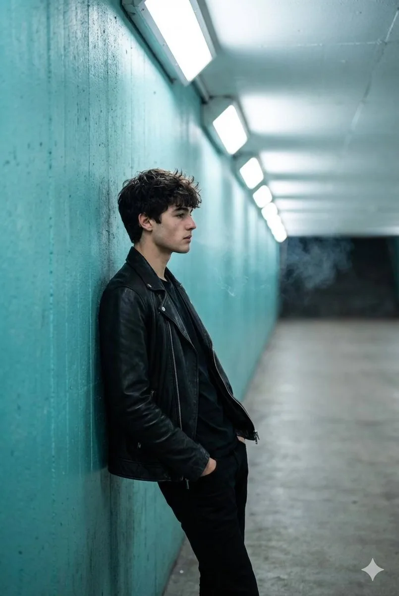

# Harboriis — by @harboriis

[← Back to Community Examples](../../EXAMPLES.md) · Category: Photography · Model: `Nano Banana`

<a href="https://x.com/harboriis/status/2017213008729244087"></a>

Source: **[@harboriis on X](https://x.com/harboriis/status/2017213008729244087)** · Creator: [Harboriis](https://x.com/harboriis)

## Prompt

```text
A full shot captures a young man in profile, leaning against a textured turquoise wall inside a brightly lit tunnel. He is dressed in a sleek black leather jacket and black pants. His short, dark hair is casually styled, framing a contemplative expression as he gazes forward. Wisps of smoke curl subtly above his head. The background features a series of evenly spaced rectangular lights along the tunnel's ceiling, creating a strong sense of depth and leading the eye. The overall lighting casts a cool, ethereal glow on the scene, with the vibrant turquoise of the walls contrasting with the stark brightness of the lights. The image conveys a mood of quiet introspection and urban coolness.
```

## Try it

Paste the prompt into **[vinano.ai](https://vinano.ai?utm_source=github&utm_medium=readme&utm_campaign=awesome-image-video-prompts-updating&utm_content=x-page-try)** to generate your own version.

> The image and prompt belong to @harboriis ([original post](https://x.com/harboriis/status/2017213008729244087)) and are shown here with credit for reference. Creators can ask for changes or removal by opening an issue.
