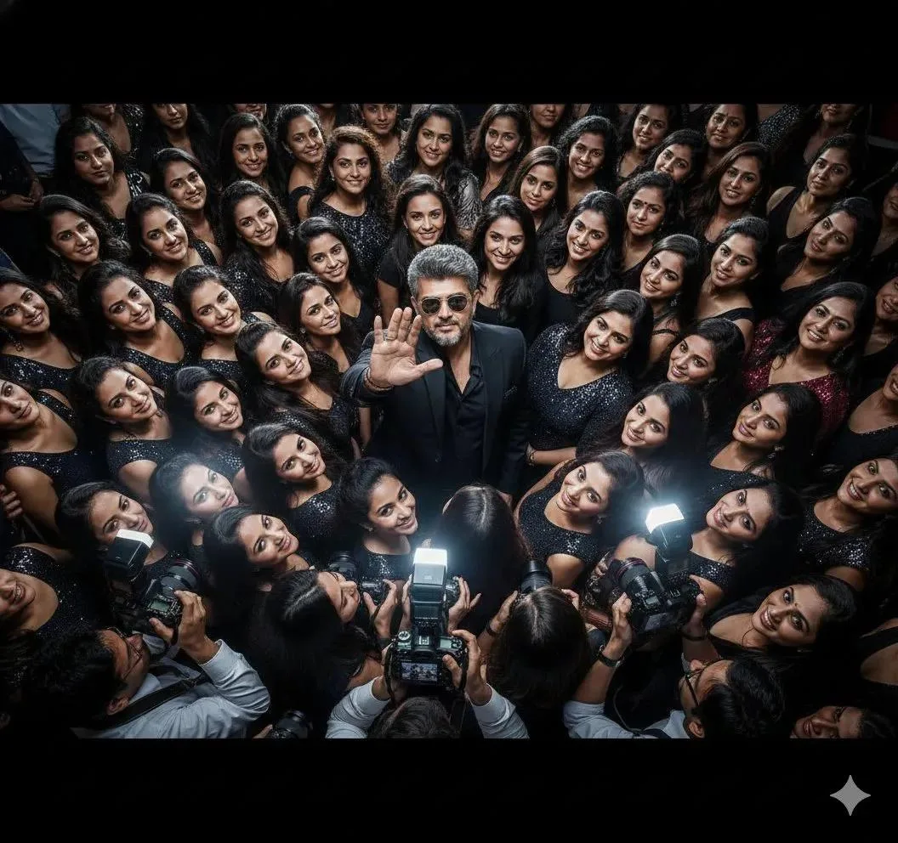

# Ꮋꭼꭺꭱꭲ Ꮋꭺꮯꮶꭼꭱ 💫 — by @hearthacker031

[← Back to Examples from X](../../EXAMPLES.md) · Category: Photography · Model: `Nano Banana`

<a href="https://x.com/hearthacker031/status/2010175109013877160"></a>

Original post: **[@hearthacker031 on X](https://x.com/hearthacker031/status/2010175109013877160)** · Creator: [Ꮋꭼꭺꭱꭲ Ꮋꭺꮯꮶꭼꭱ 💫](https://x.com/hearthacker031)

## Prompt

```text
{
  "prompt": "A hyper-realistic, ultra-detailed 8K cinematic photograph captured from a high-angle perspective using a wide-angle lens, looking directly downward into a dense, almost circular crowd, creating a strong sense of enclosure and spotlight focus.\n\nAt the center stands a confident man wearing a dark tailored suit with a dark collared shirt and round sunglasses. Use the uploaded face strictly as reference to preserve the exact identity and facial features. His right hand is raised toward the camera with the palm facing outward in a clear 'stop' or 'talk to the hand' gesture, conveying authority and control.\n\nHe is completely surrounded by a tightly packed crowd of smiling women, forming a near-perfect circle around him. The women are dressed in dark, elegant, or subtly shimmering evening attire. Their faces and shoulders densely fill the mid-ground, many looking toward the central man or directly at the camera, enhancing the sense of attention and chaos.\n\nIn the immediate foreground at the bottom of the frame, multiple photographers are visible holding professional DSLR cameras equipped with large external flash units. The flashes are actively firing, producing intense, direct frontal lighting on the central figures.\n\nLighting and mood: Dramatic, high-contrast paparazzi-style lighting with blown-out highlights on faces and clothing, sharp rim lighting on some figures, and deep, near-black shadows in the background. The lighting emphasizes a glamorous yet chaotic paparazzi frenzy.\n\nVisual quality: Extremely sharp focus on the main subjects, hyper-detailed textures on skin, fabric, sunglasses, and camera equipment. Cinematic color grading, realistic skin tones, shallow depth of field where appropriate, premium editorial photography aesthetic.",
  "negative_prompt": "low resolution, blur, soft focus, cartoon, illustration, CGI, distorted anatomy, extra limbs, extra fingers, washed-out colors, flat lighting, studio setup, empty background, watermark, logo, text",
  "aspect_ratio": "2:3",
  "style": "hyper-realistic cinematic",
  "lighting": "high-contrast paparazzi flash lighting",
  "camera": "DSLR, wide-angle lens, high-angle shot",
  "resolution": "8K",
  "quality": "ultra high"
}
```

## Try it

Paste the prompt into **[vinano.ai](https://vinano.ai?utm_source=github&utm_medium=readme&utm_campaign=awesome-image-video-prompts-updating&utm_content=x-page-try)** to generate your own version.

> The image and prompt belong to [@hearthacker031](https://x.com/hearthacker031) and are shown here with credit for reference. Creators can ask for changes or removal by opening an issue.
