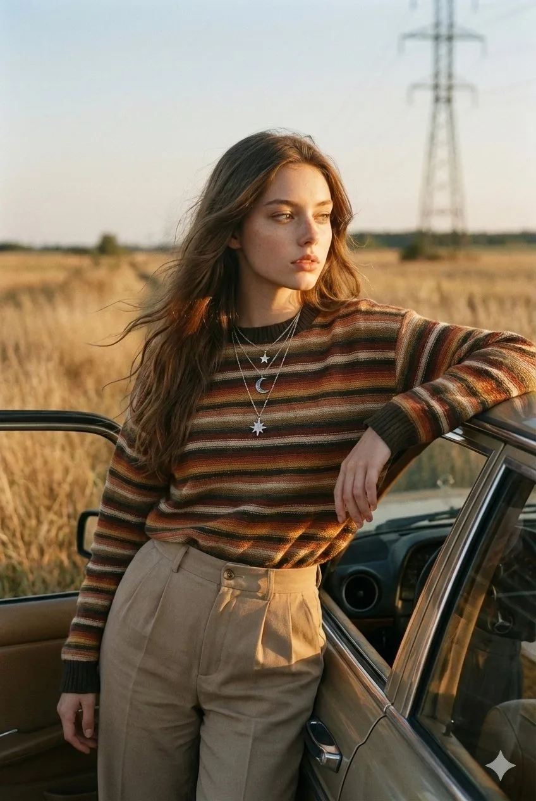

# Harboriis — by @harboriis

[← Back to Examples from X](../../EXAMPLES.md) · Category: Photography · Model: `Nano Banana`

<a href="https://x.com/harboriis/status/2009915869489504532"></a>

Original post: **[@harboriis on X](https://x.com/harboriis/status/2009915869489504532)** · Creator: [Harboriis](https://x.com/harboriis)

## Prompt

```text
{
  "image_generation": {
    "reference": {"use_uploaded_photo": true, "role": "main subject", "identity_preservation": true},
    "scene": {
      "location": "rural countryside",
      "background": ["tall dry grass fields", "distant metal powerline tower"],
      "time": "golden hour",
      "atmosphere": "calm, nostalgic road trip mood"
    },
    "subject": {
      "pose": "casually leaning against a vintage car, one arm resting on the open door frame",
      "expression": "thoughtful, relaxed, looking off to the side",
      "hair": "gently moved by the wind",
      "style": "natural, candid portrait"
    },
    "outfit": {
      "top": "retro striped sweater in warm earthy tones",
      "bottom": "high waisted beige trousers"
    },
    "lighting": {"type": "soft sunset light", "highlights": "warm", "shadows": "cool", "contrast": "soft"},
    "camera": {
      "lens": "35mm analog look",
      "depth_of_field": "shallow",
      "focus": "sharp on subject, smooth background falloff",
      "composition": "editorial fashion portrait"
    },
    "color_grading": {"style": "muted vintage tones", "saturation": "slightly reduced", "film_grain": "subtle"},
    "quality": {"realism": "high", "texture": "natural skin and fabric detail", "render": "cinematic, editorial, realistic"}
  }
}
```

## Try it

Paste the prompt into **[vinano.ai](https://vinano.ai?utm_source=github&utm_medium=readme&utm_campaign=awesome-image-video-prompts-updating&utm_content=x-page-try)** to generate your own version.

> The image and prompt belong to [@harboriis](https://x.com/harboriis) and are shown here with credit for reference. Creators can ask for changes or removal by opening an issue.
