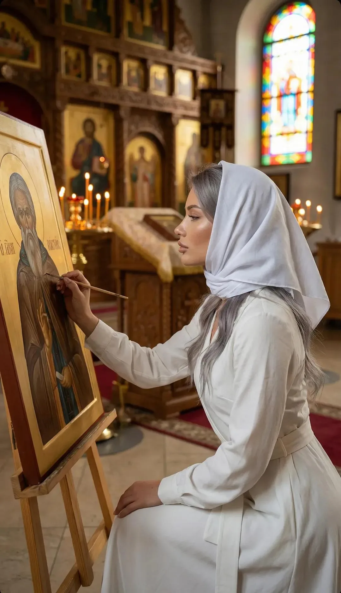

# simply — by @kingofdairyque

[← Back to Examples from X](../../EXAMPLES.md) · Category: Photography · Model: `Nano Banana`

<a href="https://x.com/kingofdairyque/status/2008902313898033412"></a>

Original post: **[@kingofdairyque on X](https://x.com/kingofdairyque/status/2008902313898033412)** · Creator: [simply](https://x.com/kingofdairyque)

## Prompt

```text
A high-realism, professional editorial photograph inside an Orthodox church.
A young woman with natural facial proportions and a calm, focused expression is kneeling on the stone floor, seated back on her heels. She wears an elegant white long-sleeve dress with a high neckline and a fabric belt tied at the waist; the fabric shows realistic folds, weight, and subtle texture. Her head is modestly covered with a traditional white headscarf (kosynka), softly draped and slightly translucent at the edges.
She is positioned in right side profile, holding a thin paintbrush in her right hand, carefully applying paint to a large Orthodox icon placed on a wooden easel in front of her. The brush gently touches the icon's surface, emphasizing a moment of concentration and reverence.
The icon depicts an elderly Orthodox saint with a long grey beard, dressed in traditional liturgical garments, with a softly glowing golden halo. Cyrillic inscriptions are visible on the icon, including "IC XC" and other Church Slavonic lettering. The saint holds a small icon in his hands. The painted surface shows realistic craquelure, brush strokes, gold leaf imperfections, and aged varnish.
Background: a richly decorated iconostasis filled with golden icons set in arched frames, carved wooden details, burning candles and hanging oil lamps. On the right side, a tall arched stained-glass window casts soft multicolored light onto the floor, creating subtle rainbow reflections. On the left, part of the altar is visible with a cross and additional icons.
Lighting is warm, layered, and atmospheric — golden ambient candlelight combined with soft natural light from the window, creating gentle shadows and depth. Skin appears fully natural with visible pores, subtle tonal variations, and no artificial smoothing. Makeup is refined and realistic, enhancing the eyes and lips without exaggeration.
Camera perspective: 50–85mm lens look, shallow depth of field, sharp focus on the woman's face, hand, and brush, with the background softly blurred. High optical clarity, true-to-life color balance, realistic exposure. The composition emphasizes the contrast between the matte white fabric of the dress and the luminous gold tones of the iconostasis. Ultra-realistic, photographic, human, non-stylized.
```

## Try it

Paste the prompt into **[vinano.ai](https://vinano.ai?utm_source=github&utm_medium=readme&utm_campaign=awesome-image-video-prompts-updating&utm_content=x-page-try)** to generate your own version.

> The image and prompt belong to [@kingofdairyque](https://x.com/kingofdairyque) and are shown here with credit for reference. Creators can ask for changes or removal by opening an issue.
