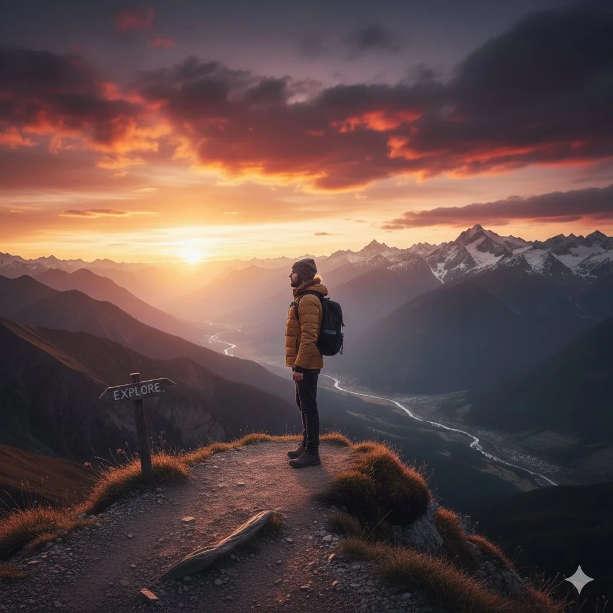

# Cuties — by @cuties7377

[← Back to Community Examples](../../EXAMPLES.md) · Category: Photography · Model: `Nano Banana`

<a href="https://x.com/cuties7377/status/2011735232366416223"></a>

Source: **[@cuties7377 on X](https://x.com/cuties7377/status/2011735232366416223)** · Creator: [Cuties](https://x.com/cuties7377)

## Prompt

```text
{
  "content_goal": "clean, elegant, viral side-pose visual",
  "image_type": "ultra-photorealistic lifestyle / editorial portrait",
  "visual_style": {
    "aesthetic": "cinematic, editorial, modern minimalism",
    "vibe": "confident, graceful, premium",
    "realism": "high-end professional realism"
  },
  "composition": {
    "framing": "mid-to-full body side view",
    "camera_angle": "true side angle (90-degree profile)",
    "subject_position": "slightly off-center for balance",
    "perspective": "clean silhouette with depth"
  },
  "subject": {
    "description": "confident individual captured in side profile",
    "pose": "standing or seated side pose with elongated posture",
    "body_language": "relaxed yet strong, controlled stance",
    "expression": "calm confidence, subtle elegance",
    "gaze": "forward or slightly downward"
  },
  "facial_details": {
    "emotion": "composed, self-assured",
    "micro_details": "natural skin texture, defined profile lines"
  },
  "wardrobe": {
    "clothing": "form-fitting or flowing outfit highlighting profile",
    "textures": "smooth, soft fabric with natural folds",
    "color_tones": "neutral, monochrome, or muted pastels"
  },
  "lighting": {
    "type": "directional studio or natural lighting",
    "quality": "soft yet sculpting",
    "direction": "side-lit to enhance contours",
    "highlight_focus": "face profile, shoulder line, waist curve",
    "shadow_style": "gentle, controlled shadows"
  },
  "color_palette": {
    "primary": ["soft neutrals", "warm skin tones", "subtle shadows"],
    "mood": "clean, elegant, confident"
  },
  "environment": {
    "location": "minimal studio, modern interior, or outdoor urban space",
    "background": "simple gradient or uncluttered backdrop",
    "atmosphere": "premium, calm, stylish"
  },
  "camera_details": {
    "camera_type": "professional camera simulation",
    "lens": "50mm or 85mm portrait lens",
    "focus": "sharp focus on profile",
    "depth_of_field": "soft background blur",
    "resolution": "editorial-grade clarity"
  },
  "quality_control": {
    "anatomy_accuracy": "natural posture and proportions",
    "fabric_realism": "realistic drape and texture",
    "ai_artifacts": "none",
    "professional_finish": "magazine-quality output"
  },
  "overall_mood": "confident, refined, cinematic",
  "intended_use": {
    "primary": "viral aesthetic post on X",
    "secondary": "personal branding, editorial photography"
  }
}
```

## Try it

Paste the prompt into **[vinano.ai](https://vinano.ai?utm_source=github&utm_medium=readme&utm_campaign=awesome-image-video-prompts-updating&utm_content=x-page-try)** to generate your own version.

> The image and prompt belong to @cuties7377 ([original post](https://x.com/cuties7377/status/2011735232366416223)) and are shown here with credit for reference. Creators can ask for changes or removal by opening an issue.
