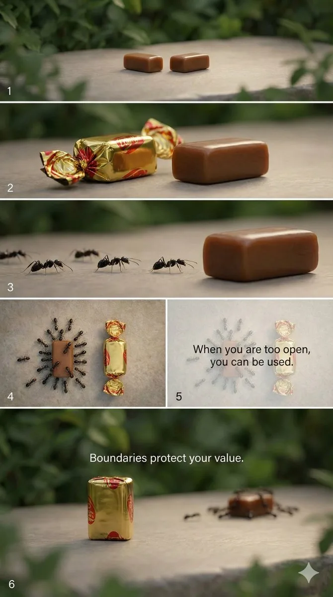

# simeon-sanai — by @Naiknelofar788

[← Back to Community Examples](../../EXAMPLES.md) · Category: Product & Brand · Model: `Nano Banana`

<a href="https://x.com/Naiknelofar788/status/2017460732938621180"></a>

Source: **[@Naiknelofar788 on X](https://x.com/Naiknelofar788/status/2017460732938621180)** · Creator: [simeon-sanai](https://x.com/Naiknelofar788)

## Prompt

```text
{
  "style": "cinematic, symbolic, minimal, realistic",
  "aspect_ratio": "9:16",
  "scenes": [
    {
      "scene_number": 1,
      "description": "A quiet outdoor setting with a clean surface under soft natural light. Two identical toffees are placed side by side.",
      "camera": "slow zoom-in",
      "mood": "calm, neutral"
    },
    {
      "scene_number": 2,
      "description": "One toffee is neatly wrapped in shiny paper. The other toffee is unwrapped, fully exposed.",
      "camera": "static close-up",
      "mood": "contrast, anticipation"
    },
    {
      "scene_number": 3,
      "description": "Ants begin to appear and slowly crawl toward the unwrapped toffee, completely ignoring the wrapped one.",
      "camera": "macro shot, slow motion",
      "mood": "uneasy, revealing"
    },
    {
      "scene_number": 4,
      "description": "More ants gather around the unwrapped toffee, covering it, while the wrapped toffee remains untouched and protected.",
      "camera": "top-down shot",
      "mood": "warning, realization"
    },
    {
      "scene_number": 5,
      "description": "Text fades in on screen as the ants swarm the unwrapped toffee.",
      "text_overlay": "When you are too open, you can be used.",
      "camera": "gentle fade",
      "mood": "reflective"
    },
    {
      "scene_number": 6,
      "description": "Final frame focuses on the wrapped toffee standing alone, clean and intact.",
      "text_overlay": "Boundaries protect your value.",
      "camera": "slow zoom-out",
      "mood": "empowering, calm"
    }
  ],
  "audio": {
    "background_music": "soft ambient piano",
    "sound_effects": "subtle nature ambience"
  }
}
```

## Try it

Paste the prompt into **[vinano.ai](https://vinano.ai?utm_source=github&utm_medium=readme&utm_campaign=awesome-image-video-prompts-updating&utm_content=x-page-try)** to generate your own version.

> The image and prompt belong to @Naiknelofar788 ([original post](https://x.com/Naiknelofar788/status/2017460732938621180)) and are shown here with credit for reference. Creators can ask for changes or removal by opening an issue.
