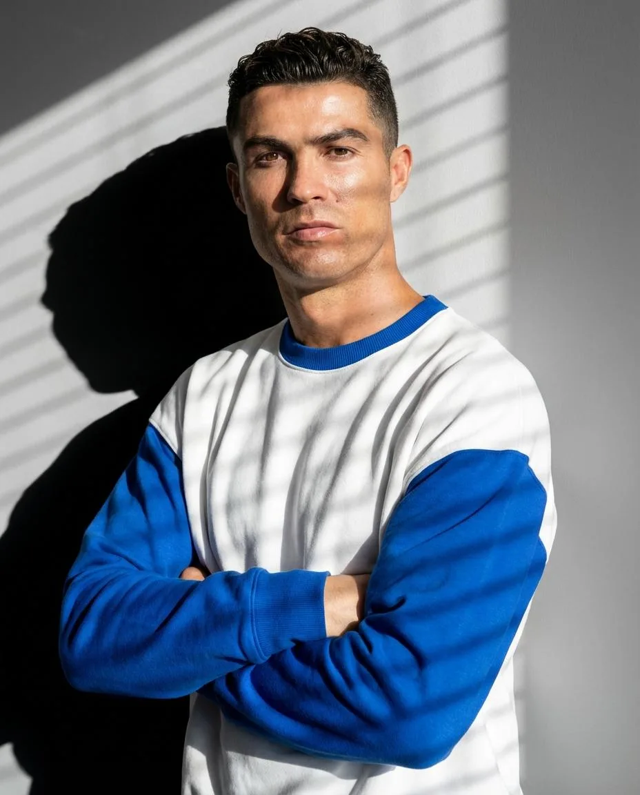

# Taaruk — by @Taaruk_

[← Back to Examples from X](../../EXAMPLES.md) · Category: Photography · Model: `Nano Banana`

<a href="https://x.com/Taaruk_/status/2030277890844262604"></a>

Original post: **[@Taaruk_ on X](https://x.com/Taaruk_/status/2030277890844262604)** · Creator: [Taaruk](https://x.com/Taaruk_)

## Prompt

```text
Ultra-realistic fashion studio portrait of a confident man and woman standing with arms crossed, wearing matching white sweatshirts with blue sleeves, dramatic sunlight streaming through window blinds casting striped shadows across their faces and clothing, clean minimal studio background, strong facial features, natural skin texture, cinematic lighting, high contrast shadow patterns, editorial fashion photography style, 85mm lens, shallow depth of field, ultra-detailed skin and fabric texture, professional studio lighting, 8K.
```

## Try it

Paste the prompt into **[vinano.ai](https://vinano.ai?utm_source=github&utm_medium=readme&utm_campaign=awesome-image-video-prompts-updating&utm_content=x-page-try)** to generate your own version.

> The image and prompt belong to [@Taaruk_](https://x.com/Taaruk_) and are shown here with credit for reference. Creators can ask for changes or removal by opening an issue.
