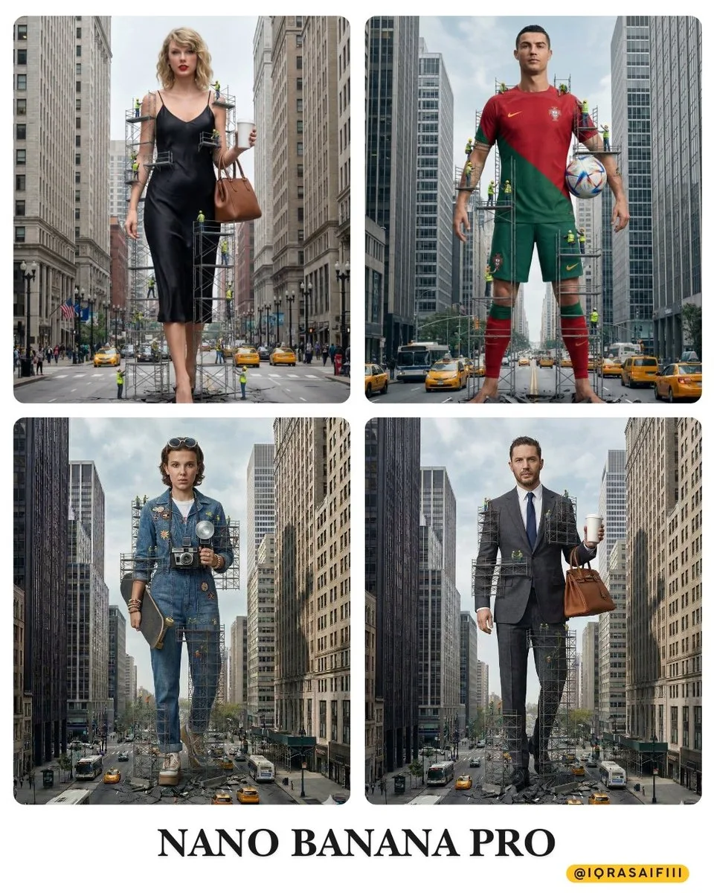

# Iqra Saifi — by @IqraSaifiii

[← Back to Community Examples](../../EXAMPLES.md) · Category: Photography · Model: `Nano Banana`

<a href="https://x.com/IqraSaifiii/status/2011072648303018074"></a>

Source: **[@IqraSaifiii on X](https://x.com/IqraSaifiii/status/2011072648303018074)** · Creator: [Iqra Saifi](https://x.com/IqraSaifiii)

## Prompt

```text
{
  "description": "A colossal woman standing in a city street, appearing to be 'under construction' with scaffolding surrounding her body.",
  "aesthetic": "Hyper-realistic composite, cinematic, urban fantasy.",
  "subject_details": {
    "celebrity_likeness": "Taylor Swift.",
    "features": {
      "face": "Blue eyes, signature red lipstick, distinct facial structure.",
      "hair": "Golden blonde, long, wavy texture cascading over shoulders."
    },
    "apparel": {
      "dress": "Black satin slip dress with a deep V-neck and a high slit on the right thigh.",
      "accessories": "Holding a standard white disposable coffee cup in the right hand. Carrying a brown leather luxury handbag in the left hand.",
      "footwear": "Bare feet or heels (obscured by street debris/cracks)."
    }
  },
  "surreal_elements": {
    "scaffolding": "Intricate metal construction scaffolding structures built around her arms, torso, and legs, following the contour of her body.",
    "miniatures": "Tiny construction workers in yellow hard hats and high-vis vests climbing the scaffolding on her body.",
    "destruction": "The asphalt street beneath her feet is cracking and shattering under the immense weight, creating a crater pattern."
  },
  "exact_pose_anatomical": {
    "posture": "Standing tall with a slight contrapposto (weight shifted to one hip).",
    "orientation": "Front-facing, towering over the viewer/city.",
    "right_arm": "Bent at the elbow, raised to hold the coffee cup at chest level.",
    "left_arm": "Extended downwards holding the handbag.",
    "gaze": "Direct, calm eye contact with the camera.",
    "scale": "Subject appears to be approximately 50 stories tall, matching the height of surrounding skyscrapers."
  },
  "environment": {
    "location": "Avenue in a major metropolis (resembling Chicago or NYC).",
    "elements": "Skyscrapers flanking both sides, busy traffic with miniature yellow taxis and buses way below.",
    "perspective": "Aerial view relative to the city, but eye-level relative to the subject."
  },
  "camera_technical_values": {
    "lens": "35mm (Wide angle to capture the full scale of the subject against the skyline).",
    "aperture": "f/11 (Deep depth of field to keep both the giant subject and the city background relatively sharp).",
    "shutter_speed": "1/500s.",
    "iso": "ISO 100.",
    "resolution": "8k, high fidelity textures."
  },
  "lighting_setup": {
    "source": "Natural Daylight.",
    "quality": "Soft, diffused sunlight (slightly overcast).",
    "direction": "Overhead/Frontal.",
    "shadows": "Subject casts a massive, long shadow onto the city streets below."
  }
}
```

## Try it

Paste the prompt into **[vinano.ai](https://vinano.ai?utm_source=github&utm_medium=readme&utm_campaign=awesome-image-video-prompts-updating&utm_content=x-page-try)** to generate your own version.

> The image and prompt belong to @IqraSaifiii ([original post](https://x.com/IqraSaifiii/status/2011072648303018074)) and are shown here with credit for reference. Creators can ask for changes or removal by opening an issue.
