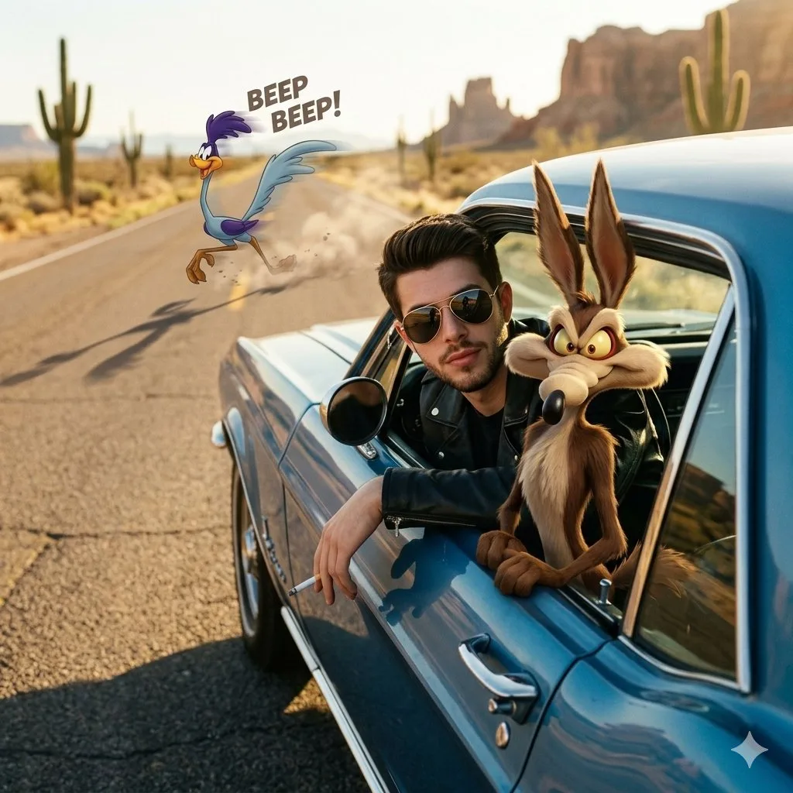

# Taaruk — by @Taaruk_

[← Back to Examples from X](../../EXAMPLES.md) · Category: Photography · Model: `Nano Banana`

<a href="https://x.com/Taaruk_/status/2044650233611907528"></a>

Original post: **[@Taaruk_ on X](https://x.com/Taaruk_/status/2044650233611907528)** · Creator: [Taaruk](https://x.com/Taaruk_)

## Prompt

```text
A stylish young man wearing a black leather jacket and aviator sunglasses leans out of the window of a vintage blue car on an empty desert highway. He casually holds a cigarette, looking confidently at the camera. Beside him, a 3D cartoon coyote character (in the style of classic animation, exaggerated features, expressive face) is sitting on the car door, interacting naturally with the real-world environment. In the background, a cartoon roadrunner is sprinting fast along the road, kicking up dust. The scene blends hyper-realistic photography with high-quality 3D animated characters seamlessly. Desert landscape with cacti, warm golden hour lighting, long shadows, cinematic depth of field, ultra-detailed textures, reflections in sunglasses, motion blur on running character, 35mm lens, f/2.0, high contrast, 8K, film still aesthetic.
```

## Try it

Paste the prompt into **[vinano.ai](https://vinano.ai?utm_source=github&utm_medium=readme&utm_campaign=awesome-image-video-prompts-updating&utm_content=x-page-try)** to generate your own version.

> The image and prompt belong to [@Taaruk_](https://x.com/Taaruk_) and are shown here with credit for reference. Creators can ask for changes or removal by opening an issue.
