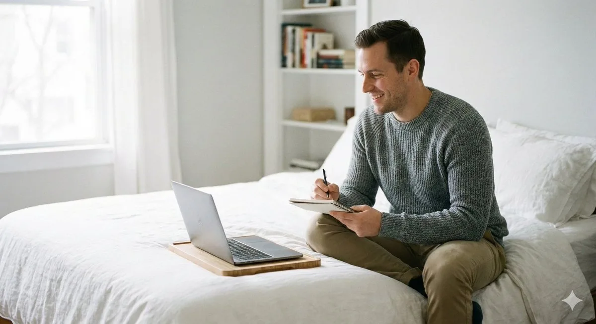

# Cuties — by @cuties7377

[← Back to Community Examples](../../EXAMPLES.md) · Category: Photography · Model: `Nano Banana`

<a href="https://x.com/cuties7377/status/2012004517638750448"></a>

Source: **[@cuties7377 on X](https://x.com/cuties7377/status/2012004517638750448)** · Creator: [Cuties](https://x.com/cuties7377)

## Prompt

```text
{
  "content_goal": "relatable, calm, lifestyle aesthetic",
  "image_type": "ultra-photorealistic lifestyle photography",
  "visual_style": {
    "aesthetic": "clean, cozy, minimal",
    "vibe": "soft, relaxed, natural",
    "realism": "high-end professional realism"
  },
  "composition": {
    "framing": "mid-shot",
    "camera_angle": "slightly above eye-level",
    "subject_position": "naturally centered",
    "perspective": "intimate but respectful"
  },
  "subject": {
    "description": "person sitting casually on a bed",
    "pose": "relaxed seated pose with legs folded or stretched comfortably",
    "body_language": "natural, unposed, confident ease",
    "expression": "calm, thoughtful, soft smile or neutral face"
  },
  "wardrobe": {
    "clothing": "casual homewear or loungewear",
    "style": "modest, relaxed fit",
    "textures": "soft cotton or linen",
    "color_tones": "neutral or pastel shades"
  },
  "environment": {
    "location": "minimal bedroom",
    "bed": "neatly arranged bed with soft pillows",
    "background": "clean wall or soft curtains",
    "atmosphere": "peaceful, morning or late-afternoon calm"
  },
  "lighting": {
    "type": "natural window light",
    "quality": "soft and diffused",
    "direction": "side lighting",
    "shadow_style": "gentle, natural shadows"
  },
  "color_palette": {
    "primary": ["warm white", "beige", "soft grey"],
    "accent": ["pastel tones"],
    "mood": "comforting and serene"
  },
  "camera_details": {
    "lens": "35mm or 50mm",
    "focus": "sharp on subject",
    "depth_of_field": "slight background blur",
    "realism": "editorial lifestyle photography"
  },
  "quality_control": {
    "skin_texture": "natural, realistic",
    "fabric_detail": "visible soft folds",
    "ai_artifacts": "none",
    "finish": "clean, professional"
  },
  "overall_mood": "casual confidence, calm presence",
  "intended_use": {
    "primary": "aesthetic lifestyle post on X",
    "secondary": "personal branding or daily vibe content"
  }
}
```

## Try it

Paste the prompt into **[vinano.ai](https://vinano.ai?utm_source=github&utm_medium=readme&utm_campaign=awesome-image-video-prompts-updating&utm_content=x-page-try)** to generate your own version.

> The image and prompt belong to @cuties7377 ([original post](https://x.com/cuties7377/status/2012004517638750448)) and are shown here with credit for reference. Creators can ask for changes or removal by opening an issue.
