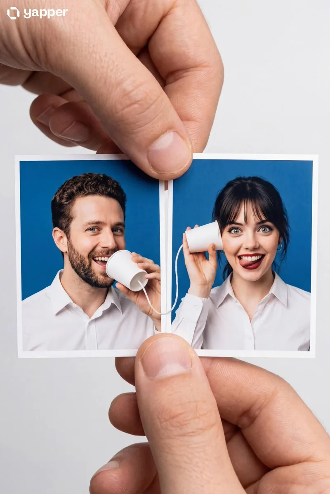

# simeon-sanai — by @Naiknelofar788

[← Back to Community Examples](../../EXAMPLES.md) · Category: Photography · Model: `Nano Banana`

<a href="https://x.com/Naiknelofar788/status/2041695940797690203"></a>

Source: **[@Naiknelofar788 on X](https://x.com/Naiknelofar788/status/2041695940797690203)** · Creator: [simeon-sanai](https://x.com/Naiknelofar788)

## Prompt

```text
Create a Portrait Master Object: Two passport-sized photo prints held side-by-side by a person's thumb and index finger.
**Passport Photo Background:** Use a solid blue background (the standard official passport photo color for Indonesian marriage books for certain even/odd birth years).
**Clothing:** Both subjects in the photo wear formal and neat white collared shirts.
**Male Subject (Left Photo):** Make his face and hair 100% similar to the given reference.
He poses as if talking into a white paper cup, with a cheerful laughing expression.
**Female Subject (Right Photo):** Make her face and hair 100% similar to the given reference.
She poses as if holding a white paper cup to her ear, listening. Her expression is funny with a wide smile and a slightly stuck-out tongue.
**Interactive Prop:** There is a white string coming out from under the male's paper cup and connecting to the female's paper cup. Because the two photos are placed next to each other, this prop creates the illusion of a "string phone" connecting the two photos.
```

## Try it

Paste the prompt into **[vinano.ai](https://vinano.ai?utm_source=github&utm_medium=readme&utm_campaign=awesome-image-video-prompts-updating&utm_content=x-page-try)** to generate your own version.

> The image and prompt belong to @Naiknelofar788 ([original post](https://x.com/Naiknelofar788/status/2041695940797690203)) and are shown here with credit for reference. Creators can ask for changes or removal by opening an issue.
