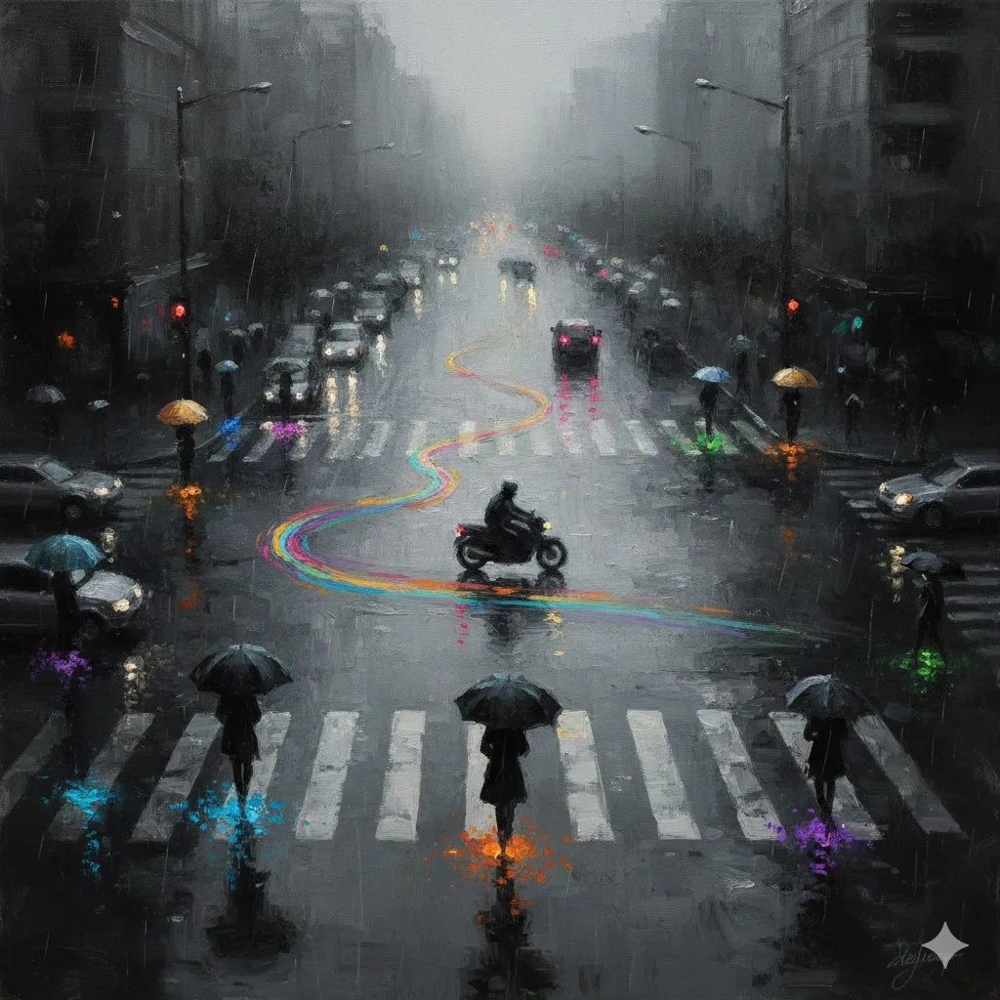

# آ — by @Mystveil7

[← Back to Community Examples](../../EXAMPLES.md) · Category: Photography · Model: `Nano Banana`

<a href="https://x.com/Mystveil7/status/2008178703705297280"></a>

Source: **[@Mystveil7 on X](https://x.com/Mystveil7/status/2008178703705297280)** · Creator: [آ](https://x.com/Mystveil7)

## Prompt

```text
A high-angle, wide-composition Impressionist oil painting of a rainy urban intersection. The scene is primarily monochrome with deep charcoal blacks and silvery grays, but features vibrant, colorful glowing lights at the footsteps of pedestrians crossing the street and beneath their umbrellas. A lone motorcyclist in the center leaves a trail of soft, colorful light, and car headlights emit small, brilliant pops of color. The style is heavily blurred and painterly, with loose, expressive brushstrokes and vague silhouettes, prioritizing mood and 'urban solitude' over sharp detail. The pavement is rain-soaked, reflecting both the gray sky and the neon-like colorful glows in shimmering, broken patterns. Misty atmosphere with distant buildings fading into soft tonal washes.
```

## Try it

Paste the prompt into **[vinano.ai](https://vinano.ai?utm_source=github&utm_medium=readme&utm_campaign=awesome-image-video-prompts-updating&utm_content=x-page-try)** to generate your own version.

> The image and prompt belong to @Mystveil7 ([original post](https://x.com/Mystveil7/status/2008178703705297280)) and are shown here with credit for reference. Creators can ask for changes or removal by opening an issue.
