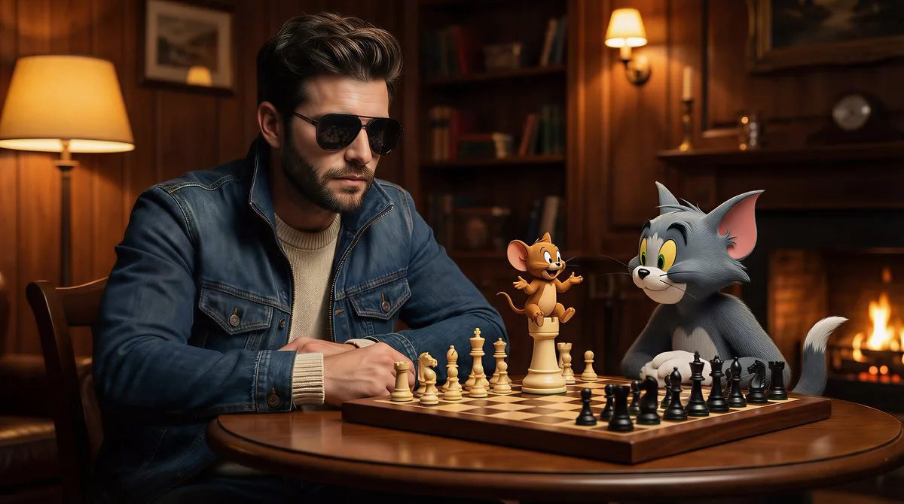

# Taaruk — by @Taaruk_

[← Back to Community Examples](../../EXAMPLES.md) · Category: Illustration & 3D · Model: `Nano Banana`

<a href="https://x.com/Taaruk_/status/2017803404022583659"></a>

Source: **[@Taaruk_ on X](https://x.com/Taaruk_/status/2017803404022583659)** · Creator: [Taaruk](https://x.com/Taaruk_)

## Prompt

```text
A cinematic, ultra-realistic scene of a stylish man wearing sunglasses and a denim jacket, seated at a round wooden table in a warm, wood-paneled study with a fireplace glowing in the background. He is playing chess against two iconic cartoon-style characters: a grey animated cat and a small brown animated mouse. The mouse stands playfully on a chess piece while the cat focuses on the board. Perfect blend of photorealistic human and high-quality 3D animated characters, Pixar-level rendering for the cartoons, realistic skin textures for the human. Cozy ambient lighting, cinematic shadows, shallow depth of field, dramatic composition, storytelling mood, hyper-detailed chessboard, 50mm lens look, ultra-sharp focus, 8K ultra-realistic, Hollywood movie still.
```

## Try it

Paste the prompt into **[vinano.ai](https://vinano.ai?utm_source=github&utm_medium=readme&utm_campaign=awesome-image-video-prompts-updating&utm_content=x-page-try)** to generate your own version.

> The image and prompt belong to @Taaruk_ ([original post](https://x.com/Taaruk_/status/2017803404022583659)) and are shown here with credit for reference. Creators can ask for changes or removal by opening an issue.
