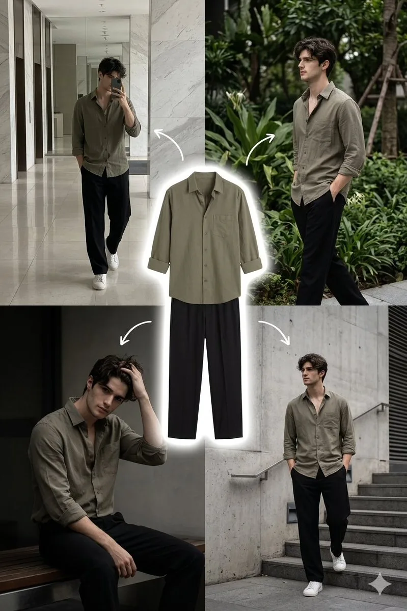

# Harboris — by @harboriis

[← Back to Examples from X](../../EXAMPLES.md) · Category: Product & Brand · Model: `Nano Banana`

<a href="https://x.com/harboriis/status/2036365607827099705"></a>

Original post: **[@harboriis on X](https://x.com/harboriis/status/2036365607827099705)** · Creator: [Harboris](https://x.com/harboriis)

## Prompt

```text
A stylish young man with medium-length wavy dark hair and a clean face, wearing a muted olive green button-up shirt with sleeves slightly rolled up, paired with loose fit black straight pants and white sneakers. The outfit looks minimal, modern, and aesthetic.
Create a fashion collage layout with 5 sections:
Center: a clean cutout of the outfit (olive shirt + black pants) placed vertically, slightly floating, with a soft white outline glow around it.
Around the center: four different lifestyle shots of the same man wearing the outfit.
Top left: indoor mirror selfie in a modern lobby with marble walls and shiny floor, holding phone covering face, relaxed walking pose.
Top right: outdoor greenery setting with plants and trees, walking pose with hands in pockets, looking sideways.
Bottom left: sitting pose on a bench or ledge, slightly leaning forward, one hand in hair, moody lighting.
Bottom right: urban street or stairs background with concrete textures, walking casually with hands in pockets.
Add minimal white curved arrows pointing from each lifestyle image toward the center outfit.
Lighting: soft natural light, slightly warm tone, cinematic shadows, Instagram aesthetic.
Color palette: neutral tones, olive green, black, white, soft greys.
Style: clean, minimal, high-end fashion lookbook, Pinterest / Instagram aesthetic.
Camera: 35mm lens, shallow depth of field, sharp subject focus.
Quality: ultra realistic, high resolution, 4K, detailed fabric texture.
```

## Try it

Paste the prompt into **[vinano.ai](https://vinano.ai?utm_source=github&utm_medium=readme&utm_campaign=awesome-image-video-prompts-updating&utm_content=x-page-try)** to generate your own version.

> The image and prompt belong to [@harboriis](https://x.com/harboriis) and are shown here with credit for reference. Creators can ask for changes or removal by opening an issue.
