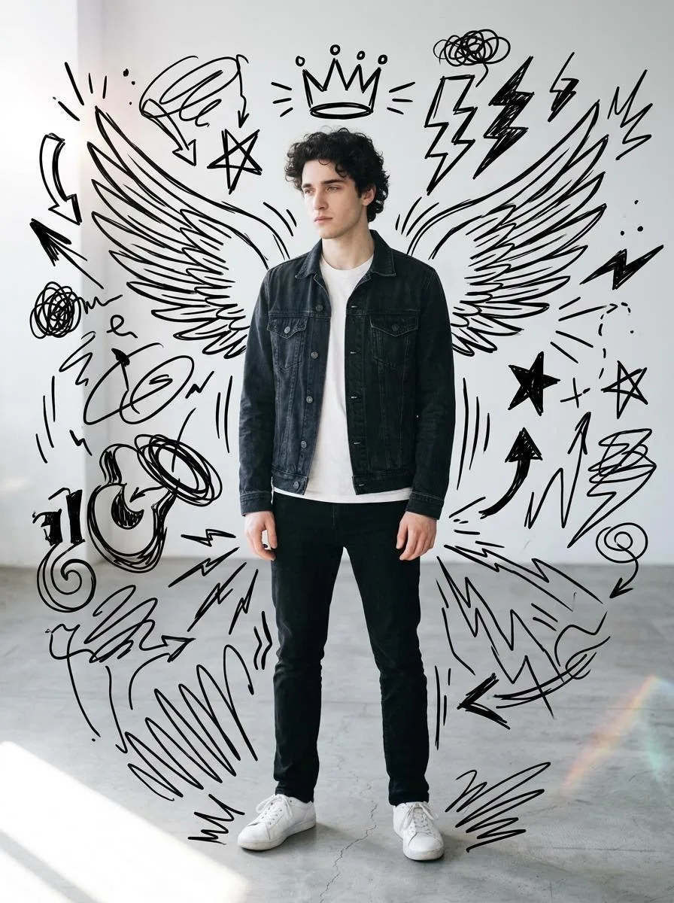

# Nikhil — by @NikhilRajX

[← Back to Community Examples](../../EXAMPLES.md) · Category: Photography · Model: `Nano Banana`

<a href="https://x.com/NikhilRajX/status/2036656563352678474"></a>

Source: **[@NikhilRajX on X](https://x.com/NikhilRajX/status/2036656563352678474)** · Creator: [Nikhil](https://x.com/NikhilRajX)

## Prompt

```text
Create a creative photo of a person using the face from the uploaded image. The person is standing in a simple environment while surrounded by hand-drawn doodle elements. Around them are sketch-style drawings like arrows, lightning, stars, scribbles, and abstract shapes, as if drawn with a marker. Some doodles interact with the person, like wings on their back, a crown above their head, or energy lines around their body. The style is a mix of real photo and doodle art. The person is wearing casual modern clothes like a t-shirt, jacket, jeans, and sneakers. The background is clean so the doodles stand out. High contrast, creative composition, slightly messy sketch style, fun and expressive, ultra detailed, modern social media aesthetic.
```

## Try it

Paste the prompt into **[vinano.ai](https://vinano.ai?utm_source=github&utm_medium=readme&utm_campaign=awesome-image-video-prompts-updating&utm_content=x-page-try)** to generate your own version.

> The image and prompt belong to @NikhilRajX ([original post](https://x.com/NikhilRajX/status/2036656563352678474)) and are shown here with credit for reference. Creators can ask for changes or removal by opening an issue.
