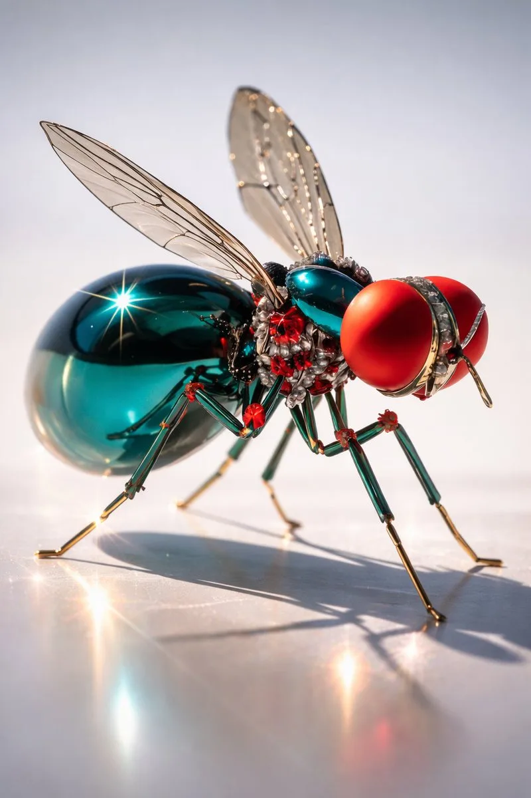

# ShaHid WaNii — by @meng_dagg695

[← Back to Community Examples](../../EXAMPLES.md) · Category: Illustration & 3D · Model: `Nano Banana`

<a href="https://x.com/meng_dagg695/status/2017858648693780480"></a>

Source: **[@meng_dagg695 on X](https://x.com/meng_dagg695/status/2017858648693780480)** · Creator: [ShaHid WaNii](https://x.com/meng_dagg695)

## Prompt

```text
{
    "resolution": "Ultra HD 8K",
    "aspect_ratio": "3:4",
    "render_quality": "extreme macro detail, studio-grade sharpness, high dynamic range",
    "lighting": "controlled studio lighting, strong specular highlights, crisp reflections, soft shadows",
    "focus": "ultra-sharp foreground, shallow depth of field background",
    "style": "hyper-detailed AI-edited macro realism",

    "MODULE_1_IMAGE_1_STYLE": {
      "subject": "mechanical insect resembling a fly",
      "pose": "standing on a reflective flat surface, body angled slightly forward, legs spread naturally",
      "body_structure": {
        "abdomen": "smooth oval metallic teal body with mirror-like reflections",
        "thorax": "complex mechanical structure with visible joints and red accent components",
        "head": "large spherical red compound eyes with matte finish",
        "legs": "thin metallic legs, green-tinted segments with gold-colored joints and tips",
        "wings": "two translucent wings with visible vein patterns, slightly raised"
      },
      "materials": {
        "primary": "polished metal, glass-like surfaces",
        "secondary": "gold-toned joints, red accent nodes"
      },
      "surface_interaction": "sharp reflections visible beneath legs and abdomen",
      "background": "clean light gray to white gradient with no visible texture",
      "visual_effects": [
        "star-like light flares on metallic surfaces",
        "high-gloss reflections",
        "precision macro clarity"
      ]
    },

    "MODULE_2_IMAGE_2_STYLE": {
      "subject": "organic fly covered with jewel-like elements",
      "pose": "standing on a dark textured surface, body angled slightly left",
      "body_structure": {
        "head": "large compound eyes with brown-gold mesh texture",
        "body": "dense black hair-like texture beneath embedded gemstones",
        "abdomen": "rounded form densely covered in diamond-like crystals",
        "legs": "thin black insect legs with fine hair details",
        "wings": "two wings fully visible, gold-veined framework filled with clear gemstone-like facets"
      },
      "materials": {
        "primary": "diamond-like crystals",
        "secondary": "gold metallic wing veins",
        "organic_elements": "fine black bristles and hairs"
      },
      "surface_interaction": "wet-looking dark ground with subtle sparkle",
      "background": "dark blurred background with soft bokeh",
      "visual_effects": [
        "micro light reflections in gemstones",
        "sparkling highlights",
        "high contrast macro lighting"
      ]
    },

    "MODULE_3_IMAGE_3_STYLE": {
      "subject": "golden mechanical mosquito-like insect",
      "pose": "feeding posture with proboscis touching skin surface",
      "body_structure": {
        "head": "smooth polished gold spherical head with visible mechanical seams",
        "proboscis": "thin metallic needle-like structure with a visible red droplet at the tip",
        "abdomen": "transparent cylindrical chamber partially filled with red liquid",
        "legs": "long thin gold metallic legs bent at sharp angles",
        "wings": "two translucent wings with gold vein structures, angled upward"
      },
      "materials": {
        "primary": "polished gold metal",
        "secondary": "clear glass-like container",
        "liquid": "deep red translucent fluid"
      },
      "surface_interaction": "human skin texture visible with pores and natural unevenness",
      "background": "dark neutral gradient with soft falloff",
      "visual_effects": [
        "precise reflections on gold surfaces",
        "realistic liquid refraction",
        "macro skin texture clarity"
      ]
    }
  }
}
```

## Try it

Paste the prompt into **[vinano.ai](https://vinano.ai?utm_source=github&utm_medium=readme&utm_campaign=awesome-image-video-prompts-updating&utm_content=x-page-try)** to generate your own version.

> The image and prompt belong to @meng_dagg695 ([original post](https://x.com/meng_dagg695/status/2017858648693780480)) and are shown here with credit for reference. Creators can ask for changes or removal by opening an issue.
