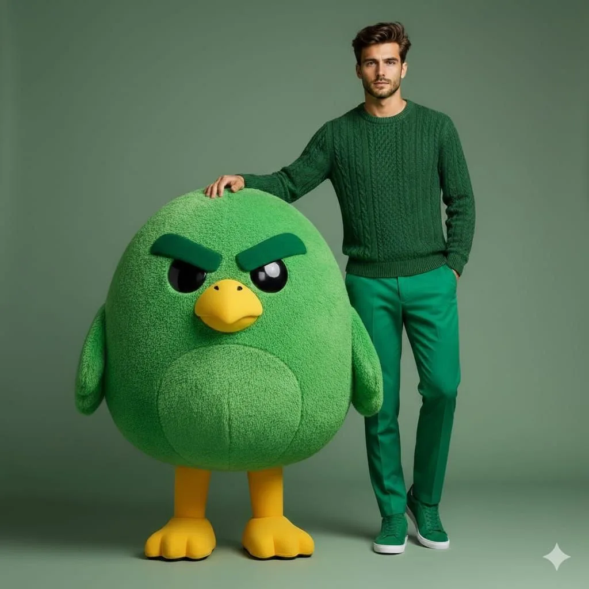

# Kashberg — by @Kashberg_0

[← Back to Community Examples](../../EXAMPLES.md) · Category: Illustration & 3D · Model: `Nano Banana`

<a href="https://x.com/Kashberg_0/status/2017953338881692117"></a>

Source: **[@Kashberg_0 on X](https://x.com/Kashberg_0/status/2017953338881692117)** · Creator: [Kashberg](https://x.com/Kashberg_0)

## Prompt

```text
High-end studio fashion portrait of a handsome male model standing beside a large plush green cartoon bird mascot. Minimal matte green background with soft tonal gradient. Model wearing a dark green cable-knit sweater, tailored emerald green trousers, and green sneakers, one hand resting casually on the mascot’s head, relaxed confident posture. Mascot is oversized, round, plush-textured, vivid green with thick expressive eyebrows, glossy eyes, and a bright yellow beak and feet. Soft diffused studio lighting, subtle shadows, ultra-sharp focus, rich fabric and texture detail, premium fashion campaign aesthetic, clean composition, modern playful luxury vibe, high resolution.
```

## Try it

Paste the prompt into **[vinano.ai](https://vinano.ai?utm_source=github&utm_medium=readme&utm_campaign=awesome-image-video-prompts-updating&utm_content=x-page-try)** to generate your own version.

> The image and prompt belong to @Kashberg_0 ([original post](https://x.com/Kashberg_0/status/2017953338881692117)) and are shown here with credit for reference. Creators can ask for changes or removal by opening an issue.
