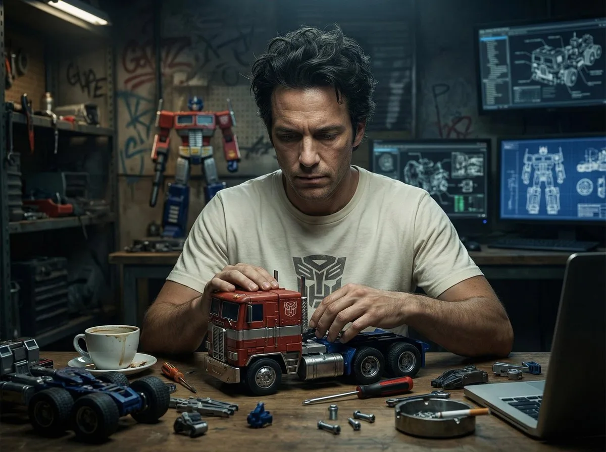

# yusra. — by @chatgptpaglu

[← Back to Community Examples](../../EXAMPLES.md) · Category: Photography · Model: `Nano Banana`

<a href="https://x.com/chatgptpaglu/status/2038836626906902918"></a>

Source: **[@chatgptpaglu on X](https://x.com/chatgptpaglu/status/2038836626906902918)** · Creator: [yusra.](https://x.com/chatgptpaglu)

## Prompt

```text
{
  "title": "Optimus Prime Toy Assembly Workshop",
  "style": "Hyper-realistic cinematic portrait",
  "composition": {
    "aspect_ratio": "9:16",
    "orientation": "vertical",
    "resolution": "16K HD",
    "depth_of_field": "shallow",
    "lighting": "dim cinematic workshop lighting focused on the subject",
    "atmosphere": "dramatic, mechanical, highly detailed"
  },
  "subject": {
    "character": "man (based on image 2)",
    "hair": "messy",
    "expression": "focused and meticulous",
    "pose": "sitting at a work table assembling a toy model",
    "clothing": {
      "tshirt_color": "ivory",
      "logo": "Autobots"
    }
  },
  "main_object": {
    "name": "Optimus Prime toy assembly model",
    "source_reference": "image 1",
    "scale": "1/4",
    "state": "partially assembled truck model",
    "box_text": "Optimus Prime – Transformers"
  },
  "environment": {
    "location": "mechanical workshop",
    "wall_details": "graffiti art",
    "computers": "screens displaying Optimus Prime assembly blueprints and mechanical diagrams",
    "tools": [
      "screwdrivers",
      "bolts",
      "robot parts",
      "mechanical components"
    ]
  },
  "table_details": {
    "objects": [
      "robot armor parts",
      "wheels",
      "mechanical pieces",
      "cup of coffee",
      "cigarette"
    ]
  },
  "background": {
    "feature": "heroic replica statue of Optimus Prime"
  },
  "visual_quality": {
    "textures": "ultra-detailed",
    "render_style": "hyper-realistic",
    "cinematic_tone": true
  }
}
```

## Try it

Paste the prompt into **[vinano.ai](https://vinano.ai?utm_source=github&utm_medium=readme&utm_campaign=awesome-image-video-prompts-updating&utm_content=x-page-try)** to generate your own version.

> The image and prompt belong to @chatgptpaglu ([original post](https://x.com/chatgptpaglu/status/2038836626906902918)) and are shown here with credit for reference. Creators can ask for changes or removal by opening an issue.
