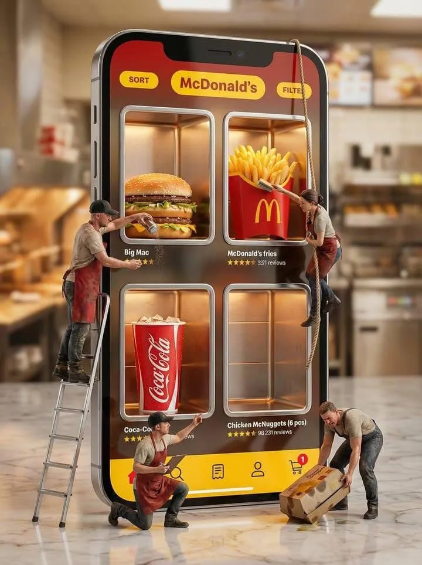

# Kashberg — by @Kashberg_0

[← Back to Examples from X](../../EXAMPLES.md) · Category: Illustration & 3D · Model: `Nano Banana`

<a href="https://x.com/Kashberg_0/status/2017516657623875632"></a>

Original post: **[@Kashberg_0 on X](https://x.com/Kashberg_0/status/2017516657623875632)** · Creator: [Kashberg](https://x.com/Kashberg_0)

## Prompt

```text
Ultra-realistic creative advertising scene showing a giant smartphone displaying a McDonald’s food-ordering app interface inside a modern restaurant kitchen. The phone screen features neatly arranged food compartments like a vending machine: a Big Mac burger, McDonald’s fries, a Coca-Cola cup, and chicken McNuggets with star ratings and reviews visible. Miniature restaurant workers in aprons interact with the phone—one climbing a rope to place fries, one on a ladder adjusting the burger, one kneeling to inspect the interface, and another lifting a delivery box. Playful scale contrast, hyper-detailed textures, glossy food realism, cinematic lighting, shallow depth of field. Premium commercial photography style, sharp focus, warm tones, high realism, imaginative brand storytelling, surreal yet believable composition.
```

## Try it

Paste the prompt into **[vinano.ai](https://vinano.ai?utm_source=github&utm_medium=readme&utm_campaign=awesome-image-video-prompts-updating&utm_content=x-page-try)** to generate your own version.

> The image and prompt belong to [@Kashberg_0](https://x.com/Kashberg_0) and are shown here with credit for reference. Creators can ask for changes or removal by opening an issue.
