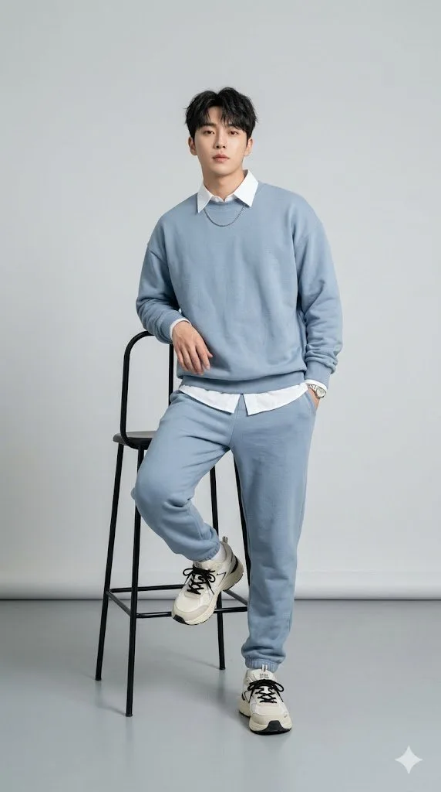

# Cherry 2.O — by @Mind_Boticni

[← Back to Community Examples](../../EXAMPLES.md) · Category: Photography · Model: `Nano Banana`

<a href="https://x.com/Mind_Boticni/status/2040029384518901953"></a>

Source: **[@Mind_Boticni on X](https://x.com/Mind_Boticni/status/2040029384518901953)** · Creator: [Cherry 2.O](https://x.com/Mind_Boticni)

## Prompt

```text
Subject & Pose

Full-body studio fashion photography of a young East Asian man with styled, dark, textured hair. He is leaning against a tall, slender black metal barstool, posing with one foot resting on the floor and the other leg bent at the knee. His expression is calm and neutral, looking directly at the camera.
Outfit & Styling

Top: A light dusty blue oversized crewneck sweatshirt layered over a crisp white collared button-down shirt, with the collar and hem visible.Bottoms: Matching light dusty blue jogger-style sweatpants.Footwear: Chunky cream and white athletic sneakers with black laces and subtle grey accents.
Technical Specifications

Lighting: Soft, even studio lighting with minimal shadows to create a clean, high-end commercial look.Background: A solid, minimalist light grey or off-white seamless studio backdrop.Composition: Vertical full-body shot, eye-level perspective, sharp focus, 8k https://t.co/rmgp3uk67G: Contemporary K-fashion editorial, soft color palette, polished and airy aesthetic.
```

## Try it

Paste the prompt into **[vinano.ai](https://vinano.ai?utm_source=github&utm_medium=readme&utm_campaign=awesome-image-video-prompts-updating&utm_content=x-page-try)** to generate your own version.

> The image and prompt belong to @Mind_Boticni ([original post](https://x.com/Mind_Boticni/status/2040029384518901953)) and are shown here with credit for reference. Creators can ask for changes or removal by opening an issue.
