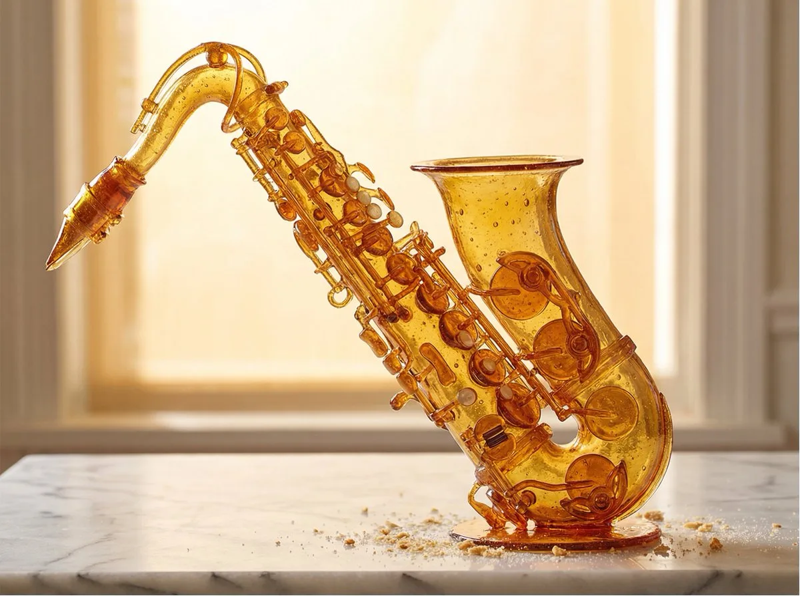

# Alexandra Aisling — by @AllaAisling

[← Back to Community Examples](../../EXAMPLES.md) · Category: Illustration & 3D · Model: `Nano Banana`

<a href="https://x.com/AllaAisling/status/2016530202692571465"></a>

Source: **[@AllaAisling on X](https://x.com/AllaAisling/status/2016530202692571465)** · Creator: [Alexandra Aisling](https://x.com/AllaAisling)

## Prompt

```text
A [PRODUCT] rendered as if built entirely from pulled and blown sugar, the translucent amber material of patisserie showpieces forming functional object. Visible sugar work techniques: pulled ribbons, blown bubbles, cast pieces joined with caramel. Internal air bubbles, slight amber color variation, the architectural fragility of competition sugar work. Positioned on a marble pastry surface or against cream backdrop. French patisserie tradition meets industrial design. Warm lighting that passes through the sugar, creating honey-glow internal illumination. Sharp focus, warm amber palette, edible luxury aesthetic, ultra-high resolution, the functional made confection.    

Check ALTs for ideas 👇 @AdobeFirefly
```

## Try it

Paste the prompt into **[vinano.ai](https://vinano.ai?utm_source=github&utm_medium=readme&utm_campaign=awesome-image-video-prompts-updating&utm_content=x-page-try)** to generate your own version.

> The image and prompt belong to @AllaAisling ([original post](https://x.com/AllaAisling/status/2016530202692571465)) and are shown here with credit for reference. Creators can ask for changes or removal by opening an issue.
