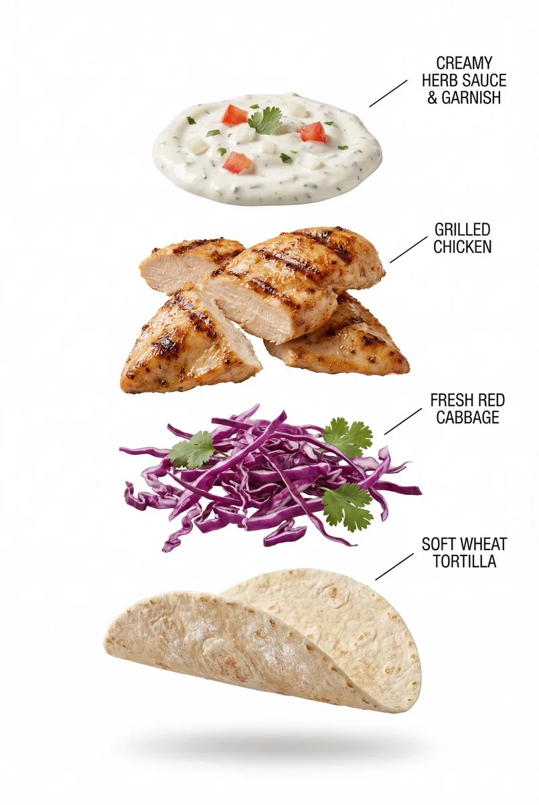

# Zara — by @ZaraIrahh

[← Back to Community Examples](../../EXAMPLES.md) · Category: Food & Drink · Model: `Nano Banana`

<a href="https://x.com/ZaraIrahh/status/2029498497431449924"></a>

Source: **[@ZaraIrahh on X](https://x.com/ZaraIrahh/status/2029498497431449924)** · Creator: [Zara](https://x.com/ZaraIrahh)

## Prompt

```text
A high-quality, professional product photograph of a grilled chicken taco filled with juicy grilled chicken pieces with visible char marks, fresh shredded red cabbage, and creamy white sauce topped with small diced tomatoes, onions, and parsley garnish, all placed inside a soft wheat taco tortilla. The taco looks fresh, flavorful, and well-filled with visible textures and vibrant ingredients. Minimalist style, shot against a pure solid white background with soft, natural shadows. 8K resolution, ultra-sharp focus, clean and modern food photography aesthetic.
```

## Try it

Paste the prompt into **[vinano.ai](https://vinano.ai?utm_source=github&utm_medium=readme&utm_campaign=awesome-image-video-prompts-updating&utm_content=x-page-try)** to generate your own version.

> The image and prompt belong to @ZaraIrahh ([original post](https://x.com/ZaraIrahh/status/2029498497431449924)) and are shown here with credit for reference. Creators can ask for changes or removal by opening an issue.
