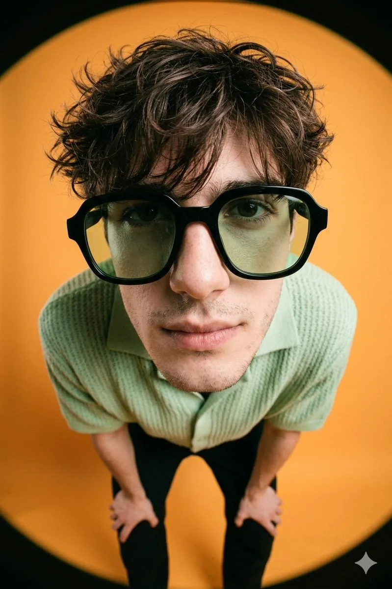

# Harboris — by @harboriis

[← Back to Community Examples](../../EXAMPLES.md) · Category: Photography · Model: `Nano Banana`

<a href="https://x.com/harboriis/status/2039904399993225374"></a>

Source: **[@harboriis on X](https://x.com/harboriis/status/2039904399993225374)** · Creator: [Harboris](https://x.com/harboriis)

## Prompt

```text
Create a A high-fashion editorial image of a young man, of the person from the uploaded character reference photo. KEEP FACE FEATURES AS ORIGINAL at all times. A high-fashion editorial image captured in an exaggerated fisheye lens close-up. The camera is angled slightly from below, and the man is crouching or squatting forward with both hands resting on his knees, leaning his upper body toward the lens. His face is looking downward into the camera, exaggerated by fisheye distortion so it appears large and rounded, with cartoonish proportions. He has a neutral smile, relaxed and completely smile, expression confident but emotionless.

He wears a trendy, summery knitted shirt in a pastel green shade light, breathable, with visible texture, reflecting Gen Z summer fashion. He also wears oversized black-framed sunglasses, with lenses tinted in light green.

The background is a clean, solid orange color with soft, realistic studio lighting, creating gentle shadows cast from his head, shoulders, and arms.

No direct sunlight light is controlled and evenly diffused, like a fashion set. The overall style is playful, surreal, and modern, inspired by 2025 Gen Z fashion culture and bold editorial covers. Ultra-clean details, slight grain, bold composition.
```

## Try it

Paste the prompt into **[vinano.ai](https://vinano.ai?utm_source=github&utm_medium=readme&utm_campaign=awesome-image-video-prompts-updating&utm_content=x-page-try)** to generate your own version.

> The image and prompt belong to @harboriis ([original post](https://x.com/harboriis/status/2039904399993225374)) and are shown here with credit for reference. Creators can ask for changes or removal by opening an issue.
