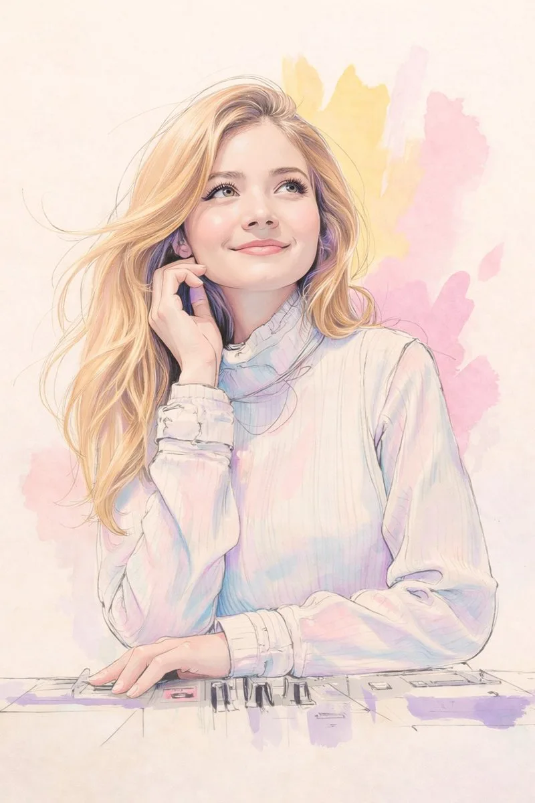

# Cherry 2.O — by @Mind_Boticni

[← Back to Examples from X](../../EXAMPLES.md) · Category: Illustration & 3D · Model: `Nano Banana`

<a href="https://x.com/Mind_Boticni/status/2017096425860215040"></a>

Original post: **[@Mind_Boticni on X](https://x.com/Mind_Boticni/status/2017096425860215040)** · Creator: [Cherry 2.O](https://x.com/Mind_Boticni)

## Prompt

```text
A soft pastel watercolor digital illustration of a young woman with long, flowing blonde hair, gently smiling and looking slightly upward to the side. She has delicate, realistic facial features, smooth glowing skin, light pink lips, and expressive eyes. She is wearing a light-colored, high-neck long-sleeve sweater with subtle fabric texture. One hand is raised near her face in a relaxed, thoughtful pose, the other resting casually on a table or surface.
The art style is a mix of hand-drawn pencil sketch and watercolor painting, with fine linework and soft pastel splashes in pink, yellow, lavender, and light blue behind her. The background is minimal and abstract, with loose watercolor brush strokes and a clean off-white canvas.
Lighting is soft and dreamy, giving a warm, optimistic, serene mood. The illustration has a modern digital watercolor aesthetic, elegant, airy, and feminine, with smooth gradients and painterly textures. High detail, artistic portrait, pastel color palette, aesthetic illustration, soft focus, gentle expression.
```

## Try it

Paste the prompt into **[vinano.ai](https://vinano.ai?utm_source=github&utm_medium=readme&utm_campaign=awesome-image-video-prompts-updating&utm_content=x-page-try)** to generate your own version.

> The image and prompt belong to [@Mind_Boticni](https://x.com/Mind_Boticni) and are shown here with credit for reference. Creators can ask for changes or removal by opening an issue.
