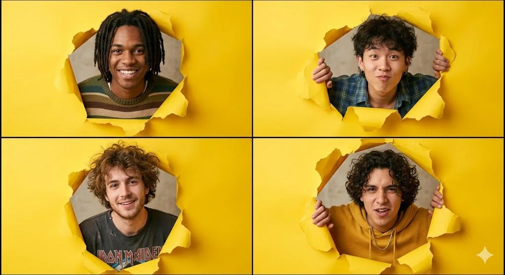

# Cherry 2.O — by @Mind_Boticni

[← Back to Examples from X](../../EXAMPLES.md) · Category: Photography · Model: `Nano Banana`

<a href="https://x.com/Mind_Boticni/status/2041840872925606344"></a>

Original post: **[@Mind_Boticni on X](https://x.com/Mind_Boticni/status/2041840872925606344)** · Creator: [Cherry 2.O](https://x.com/Mind_Boticni)

## Prompt

```text
A high-resolution 2x2 grid collage of four individual portraits. In each square, a different young man peeks through a jagged, ripped hole in bright yellow seamless paper. The subjects have a 1990s indie-pop aesthetic with diverse hairstyles, including messy curls and dreadlocks. The lighting is soft and even, typical of a professional studio photoshoot. The color palette is dominated by the vibrant yellow paper against a neutral beige background visible through the tears. Cinematic quality, sharp focus, 8k resolution, editorial photography style.
Key Elements Breakdown
If you want to tweak the result, here are the specific descriptors that make this style work:

Composition: 2x2 grid collage, quad split screen, peeking through a hole.
Main Prop: torn yellow construction paper, jagged ripped edges, seamless paper background.
Subject Style: Gen Z fashion, indie band aesthetic, 90s grunge-lite, youthful expressive faces.
Technical Specs: flat lighting, low depth of field, clean studio photography, vibrant saturation.
```

## Try it

Paste the prompt into **[vinano.ai](https://vinano.ai?utm_source=github&utm_medium=readme&utm_campaign=awesome-image-video-prompts-updating&utm_content=x-page-try)** to generate your own version.

> The image and prompt belong to [@Mind_Boticni](https://x.com/Mind_Boticni) and are shown here with credit for reference. Creators can ask for changes or removal by opening an issue.
