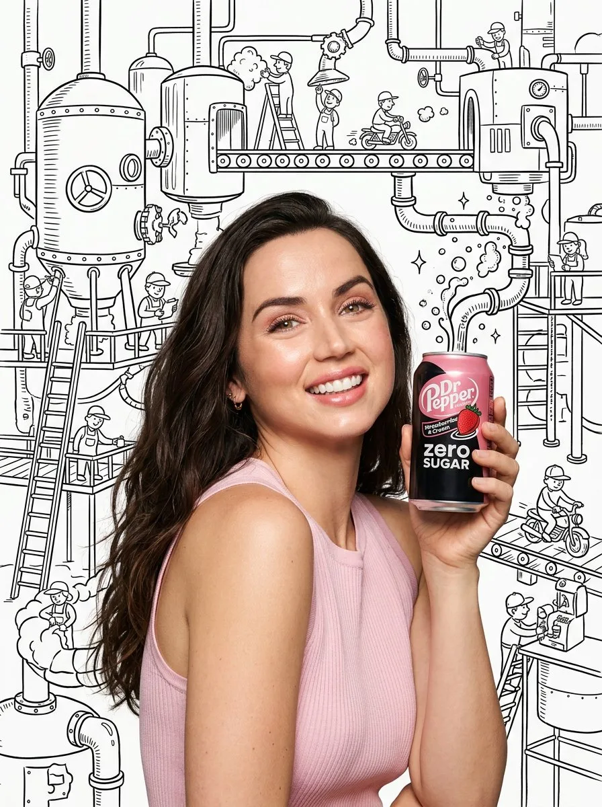

# Sharon Riley — by @Just_sharon7

[← Back to Examples from X](../../EXAMPLES.md) · Category: Illustration & 3D · Model: `Nano Banana`

<a href="https://x.com/Just_sharon7/status/2030315357651845379"></a>

Original post: **[@Just_sharon7 on X](https://x.com/Just_sharon7/status/2030315357651845379)** · Creator: [Sharon Riley](https://x.com/Just_sharon7)

## Prompt

```text
{
  "prompt": "A high-quality realistic photograph of Ana de Armas with glowing skin, long dark hair, and a bright happy smile showing teeth, holding a can of 'Dr Pepper Strawberries & Cream Zero Sugar' near her face. The background is a creative, whimsical 2D black-and-white line art illustration of a soda factory. The illustration features stylized pipes, industrial tanks, and tiny cartoon workers on ladders and motorbikes. Some of the hand-drawn pipes appear to 'connect' to the soda can, with illustrated bubbles flowing out. Ana is wearing a light pink sleeveless top, complementing the soda can aesthetic. Bright, clean studio lighting, 8k resolution, mixed media art style.",
  "key_elements": {
    "mixed_media": "Combine realistic photography of Ana de Armas with 2D hand-drawn illustration in one cohesive image",
    "contrast": "Realistic Ana pops against black-and-white line art",
    "interaction": "Illustrated pipes connect to soda can with bubbles flowing",
    "color_palette": "Light pink clothing matching pink/red tones of soda can for a high-end commercial look"
  },
  "style": "mixed media, whimsical, high-end commercial",
  "resolution": "8k",
  "lighting": "bright, clean studio lighting"
}
```

## Try it

Paste the prompt into **[vinano.ai](https://vinano.ai?utm_source=github&utm_medium=readme&utm_campaign=awesome-image-video-prompts-updating&utm_content=x-page-try)** to generate your own version.

> The image and prompt belong to [@Just_sharon7](https://x.com/Just_sharon7) and are shown here with credit for reference. Creators can ask for changes or removal by opening an issue.
