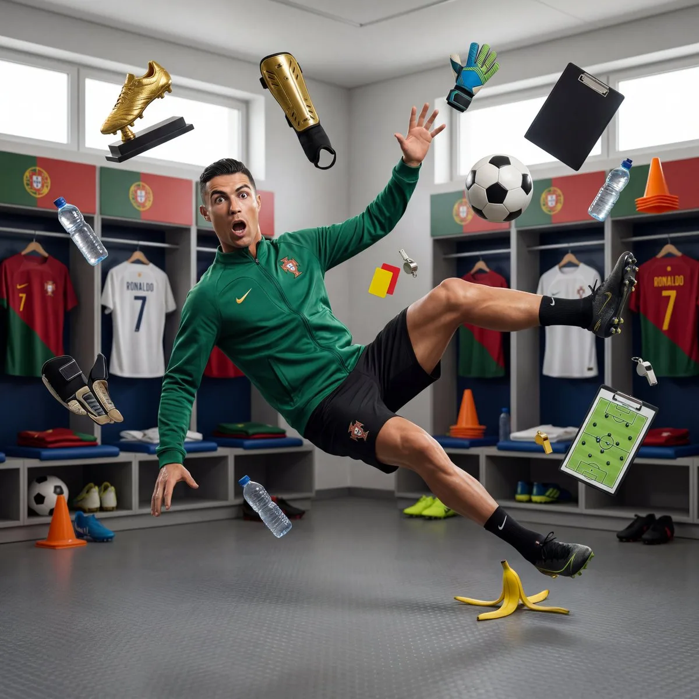

# Saul Goodman — by @Goodmanprotocol

[← Back to Community Examples](../../EXAMPLES.md) · Category: Photography · Model: `Nano Banana`

<a href="https://x.com/Goodmanprotocol/status/2044791188914671975"></a>

Source: **[@Goodmanprotocol on X](https://x.com/Goodmanprotocol/status/2044791188914671975)** · Creator: [Saul Goodman](https://x.com/Goodmanprotocol)

## Prompt

```text
8K Ultra Photorealistic cinematic freeze-frame of a {PROFESSION} slipping on a banana peel, mid-air fall with exaggerated shock expression, arms and legs extended. Preserve identity exactly. 10–15 clear {PROFESSION}-related objects floating naturally with clean spacing. Realistic environment matching the profession. Eye-level, full-body, natural lighting, realistic shadows. Style: cinematic, meme-like, controlled chaos. Avoid distortion, clutter, unrelated objects, bad lighting.
```

## Try it

Paste the prompt into **[vinano.ai](https://vinano.ai?utm_source=github&utm_medium=readme&utm_campaign=awesome-image-video-prompts-updating&utm_content=x-page-try)** to generate your own version.

> The image and prompt belong to @Goodmanprotocol ([original post](https://x.com/Goodmanprotocol/status/2044791188914671975)) and are shown here with credit for reference. Creators can ask for changes or removal by opening an issue.
